## Warm-up: Review of Session 1 — Live Quiz {.center}

:::: {.columns}
::: {.column width="45%"}

:::
::: {.column width="55%"}
Scan the QR code to join the live quiz on **How to Study** (10 questions).

[forms.gle/ykpqo3aYWRHh9vYU7](https://forms.gle/ykpqo3aYWRHh9vYU7)
:::
::::

::: {.notes}
Every lesson starts with an assessment of the previous class. Display the QR code, run the quiz, then discuss the answers before moving on.
:::

## What is the Scientific Method? {.center}

- A way to investigate the world and answer questions using **observation** and **experiment**
- A step-by-step process for exploring *how* things work and *why*
- Think of it as a detective's toolkit for solving mysteries about the world

::: {.notes}
This slide sets the tone. The scientific method is not just a boring recipe — it's a practical problem-solving tool that they use every day, even if they don't call it that. The detective analogy works well because it emphasizes curiosity and investigation.
:::

## Curiosity Drives Discovery

Science starts with **asking questions** about the world around us:

- Why is the sky blue?
- How do plants grow?
- What are stars made of?

## The Seven Steps

1. Observation
2. Question
3. Hypothesis
4. Experiment
5. Data collection
6. Data analysis
7. Conclusion

::: {.notes}
Emphasize that this is a cycle, not a straight line — scientists often go back and revise.
:::

## An Everyday Example: The Toaster {.smaller}

:::: {.columns}
::: {.column width="50%"}
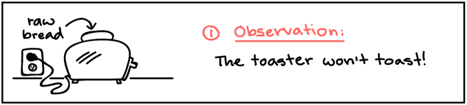{width="100%"}

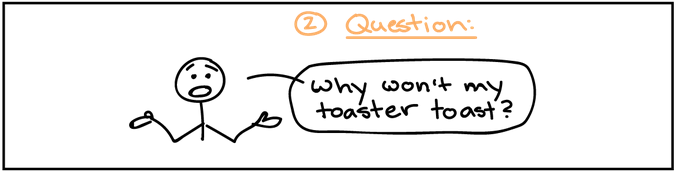{width="100%"}
:::
::: {.column width="50%"}
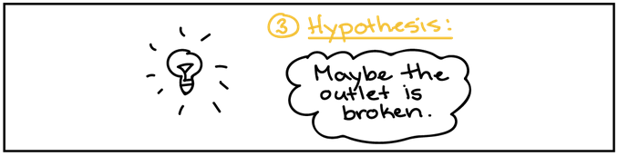{width="100%"}

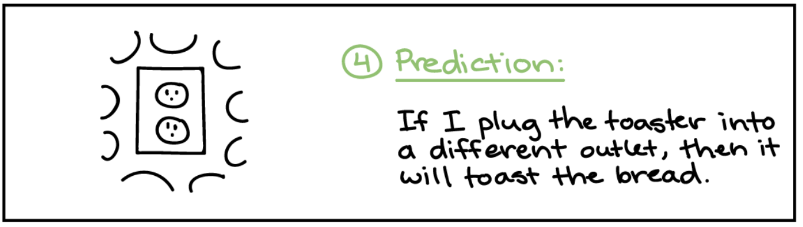{width="100%"}
:::
::::

::: {.notes}
This toaster sequence walks through steps 1–4 concretely: observation (toaster won't toast), question (why?), hypothesis (maybe the outlet), and prediction (if we try a different outlet it will work). Use this to show that the scientific method isn't just for labs — students do this at home.
:::

## Testing the Prediction

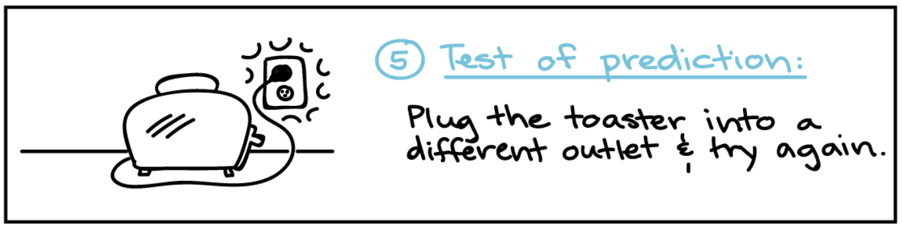{width="70%" fig-align="center"}

If the toaster still doesn't work in the new outlet, the hypothesis is **rejected** — time to try another one (maybe it's the toaster itself, not the outlet).

::: {.notes}
If the prediction fails, we don't give up — we form a new hypothesis and test again. This is why the scientific method is a cycle. Ask students: what other hypotheses could explain the toaster not working?
:::

## Science is a Cycle, Not a Line

- We often go back, revise our ideas, and try again
- Findings are **shared** so others can learn and build on them
- The scientific method isn't only for labs — we use it every day

## Step 1 — Observation

Careful, systematic scrutiny of the world.

Sources of observations:

- Direct sensory experience
- Literature review
- Findings from previous studies

## Step 2 — Question

A clear, focused inquiry based on the observation.

::: {.vocab-box}
**Vocabulary:** *ambiguous* — unclear or open to more than one interpretation.
:::

Vague questions → vague hypotheses → hard-to-design experiments.

## Step 3 — Hypothesis

A **testable and falsifiable** statement proposing an answer to the question.

- Expresses a cause-and-effect relationship
- **Falsifiability**: it must be possible to prove it wrong
- Researchers may compare several *alternative hypotheses*

::: {.callout-warning}
Watch out for **spurious correlations** — two things changing together doesn't mean one causes the other.
https://www.tylervigen.com/spurious-correlations
:::

## The Null Hypothesis

::: {.vocab-box}
**Null hypothesis (H₀)** — the claim of **no effect**: any change we observe is just due to chance.
:::

- **H₁:** Studying with flashcards improves exam scores
- **H₀:** Studying with flashcards has **no** effect on exam scores
- An experiment gathers evidence to **reject H₀** — it doesn't *prove* H₁

::: {.callout-important}
**A scientist's job is not to prove they are right.** You design the experiment to try to prove your own hypothesis *wrong* — if it survives that attempt, it gets stronger.
:::

::: {.notes}
This is a subtle but important idea: scientists don't set out to prove their hypothesis directly. They test whether the data make the "nothing is happening" explanation (H₀) unlikely. If exam scores are clearly higher with flashcards, we reject H₀ in favour of H₁. If scores are about the same, we fail to reject H₀ — that doesn't mean H₀ is true, only that we don't have enough evidence against it. This connects back to falsifiability: H₀ is the default, skeptical position you need evidence to overturn. Philosophy of science point (Popper): good science is not about confirming what you already believe — hunting only for evidence that agrees with you is confirmation bias. A real test is one that COULD have proven you wrong and didn't. Ask students: what would the null hypothesis be for the toaster example, or for Fleming's penicillin observation? And how could Fleming have been wrong?
:::

## Step 4 — Experiment

Planning and organizing the procedure that will test the hypothesis.

- **Independent variable** — the one *we* deliberately change
- **Dependent variable** — the one we *measure*

## Identifying Variables — Try It

| Scenario | Independent variable | Dependent variable |
|---|---|---|
| Plant growth | Amount of sunlight | Height of plants |
| Drug dosage | Dosage of a drug | Heart rate |
| Exam scores | **?** | Exam scores |

::: {.fragment}
What could the independent variable be in the exam scores example? (hours studied? sleep? something else?)
:::

::: {.notes}
Pause here and get answers from students. Common ones: hours studied, amount of sleep, caffeine intake, test anxiety. This is where you can tie back to their real lives — they're all doing experiments (studying vs not studying, sleeping vs staying up) and observing the outcome (exam score). Ask: which variable would YOU want to test?
:::

## Step 5 — Data Collection: Two Types of Data

| | Qualitative | Quantitative |
|---|---|---|
| **Nature** | Descriptive, not easily measured | Numerical, measurable |
| **Form** | Observations, categories | Numbers from measurement/counts |
| **Example** | Colour of a flower, texture | Height (cm), temperature (°C) |
| **Analysis** | Thematic / content analysis | Statistical methods |

::: {.notes}
Both types are valuable. Qualitative data captures nuance and description — "the plant looks healthier, has more vibrant green." Quantitative data is precise and analyzable — "the plant is 25.3 cm tall." In Fleming's penicillin experiment, qualitative observation (the clear zone around the mould) led him to the discovery, but quantitative data (how much bacterial growth was inhibited, concentration of the substance needed) was crucial for developing it as a medicine.
:::

## Precision vs. Accuracy {.smaller}

| | Precision | Accuracy |
|---|---|---|
| **Definition** | How closely repeated measurements agree with *each other* | How close a measurement is to the *true value* |
| **Associated with** | Consistency, reliability | Correctness, no systematic error |
| **Example** | Weighing something 5× and always getting 12.3 g | Weighing something and getting the true 12.5 g |

::: {.callout-tip}
It's possible to be precise but *not* accurate — consistent measurements can still all be wrong if there's a systematic error.
:::

## Precision vs. Accuracy — Try It {.smaller}

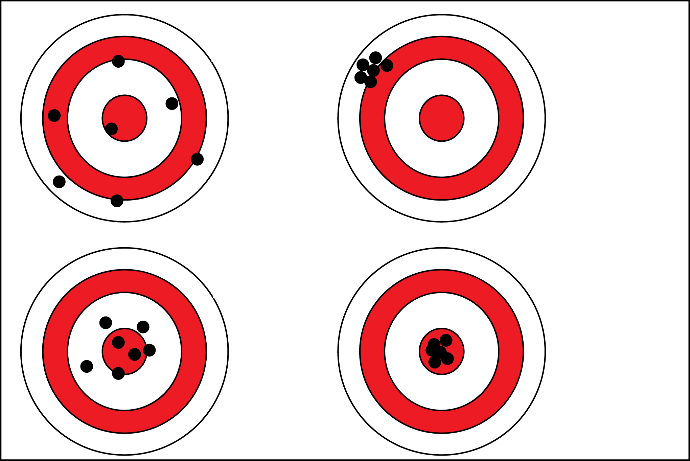{width="75%" fig-align="center"}

For each target: is it **precise**? Is it **accurate**?

::: {.notes}
Show the unlabeled targets and ask students to call out, for each quadrant, whether it shows high/low precision and high/low accuracy, before revealing the labeled version on the next slide.
:::

## Precision vs. Accuracy — Visualized

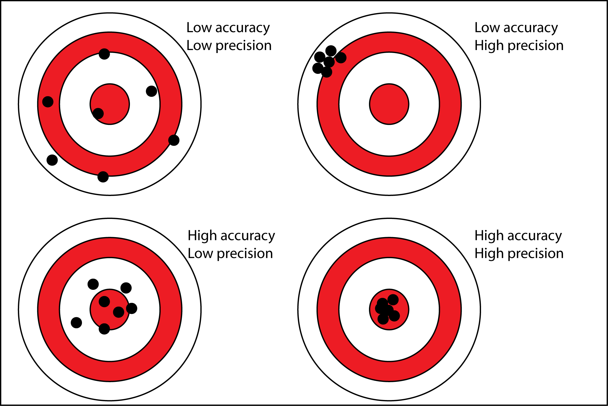{width="75%" fig-align="center"}

::: {.notes}
Walk through each quadrant. Top-left (scattered, off-center): neither precise nor accurate — measurements are all over the place and far from the bullseye. Top-right (clustered, off-center): precise but NOT accurate — they're consistent with each other, but they're clustered in the wrong place. Bottom-left (scattered, centered): accurate but not precise — they're scattered, but on average they hit the target. Bottom-right (clustered, centered): both precise AND accurate — the gold standard. Real-world example: a broken scale that always reads 2 kg too high is precise (consistent) but not accurate (wrong value).
:::

## The Control Group

Purpose of a control group:

- **Baseline comparison** — the normal state, without treatment
- **Minimizing confounding variables** — keep everything else constant
- **Establishing cause and effect**
- **Standard for comparison** against the experimental group

::: {.vocab-box}
**Vocabulary:** *confounding variable* — an outside factor that could distort the result.
:::

::: {.notes}
Without a control group, you can't tell if the outcome was caused by your variable or something else. Example: testing a new study technique on one class but not another. But if the class getting the technique is also more motivated, how do you know which caused the better grades? A control group that differs ONLY in the treatment lets you isolate the effect. This is the most common reason experiments fail — they don't properly control confounding variables.
:::

## Randomization & Replication

:::: {.columns}
::: {.column width="55%"}
- **Randomization** helps eliminate bias: assign subjects to groups by chance (e.g. a coin flip), not by choice — otherwise, say, the most motivated students could all end up in the same group
- **Replication** (repeating the trial) helps ensure results are reliable
:::
::: {.column width="45%"}
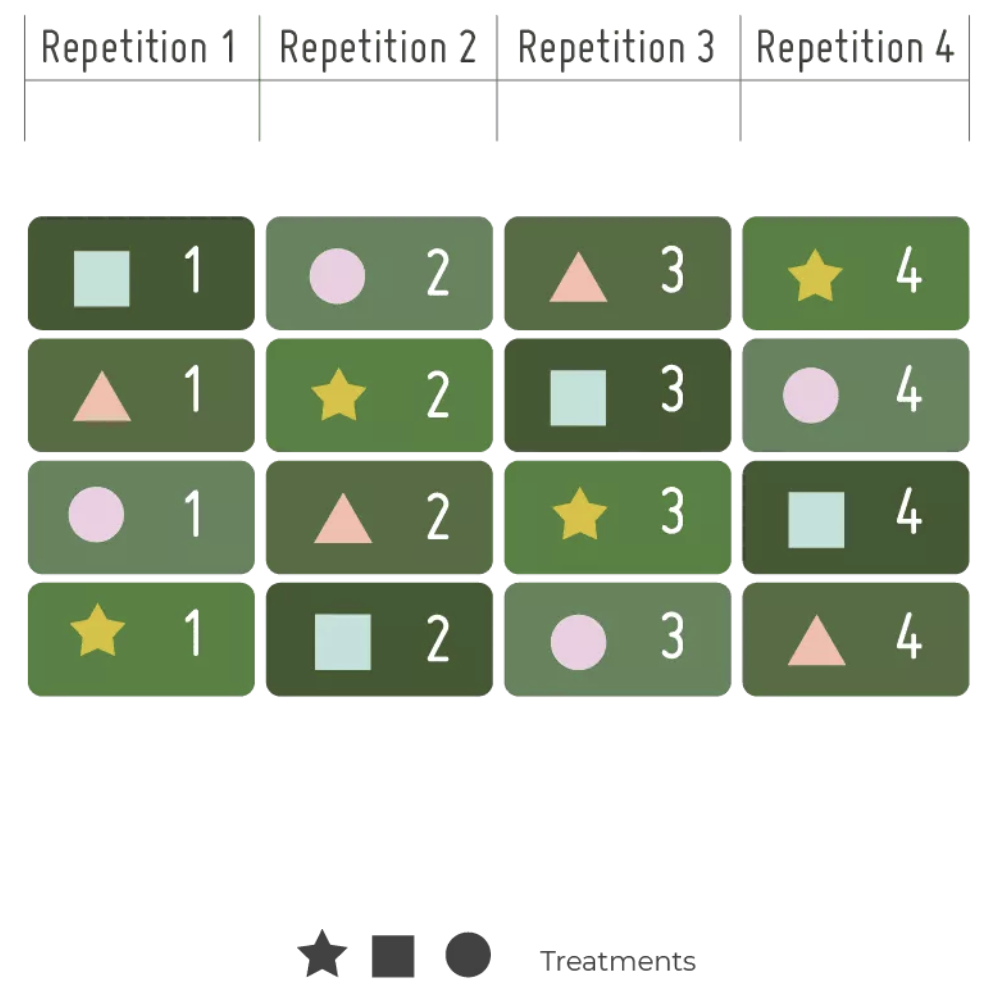{width="100%"}
:::
::::

::: {.notes}
The image shows the same treatment (star, square, circle shapes) randomly assigned to different groups across multiple repetitions. Randomization prevents you from accidentally biasing which subjects get which treatment — maybe without randomization, the most motivated students would all end up in the experimental group by chance. Replication (repeating the experiment 4 times here) shows that results are not a fluke. If you get similar results every time, you're confident in your finding.
:::

## Step 6 — Data Analysis

- **Organizing data** (data cleaning): tables, graphs, charts
- **Descriptive statistics**: mean, median, standard deviation
- **Graphical representations**: scatter plots, bar graphs, histograms, line graphs

## Step 7 — Conclusion

- Compare results **with the hypothesis**: supported, or contradicted?
- Assess **validity**: reliability of data, rigor of design, confounders
- Consider **statistical significance** and **alternative explanations**
- Discuss **generalizability** and broader **implications**
- **Communicate findings** — papers undergo peer review before publication

::: {.notes}
A good conclusion doesn't just say "we were right" or "we were wrong." It evaluates HOW CONFIDENT we should be in the result. Did we test enough subjects? Enough times? Could something else have caused the outcome? What's next? For Fleming, the conclusion was: this substance looks promising for medical use — but more research (which took 12 years and multiple scientists) was needed to develop it into a usable drug. This is why peer review matters: other experts check your logic and methods before your work becomes trusted.
:::

# Case Study: Penicillin {background-color="#1d5c9c"}

## Observation

In September 1928, Alexander Fleming was studying *Staphylococcus* bacteria at St. Mary's Hospital, London.

He left petri dishes on his workbench while on vacation.

## Observation (continued)

:::: {.columns}
::: {.column width="55%"}
Upon returning, he noticed one dish had **mould growing on it** — with a clear area around the mould where bacteria seemed to be killed.
:::
::: {.column width="45%"}
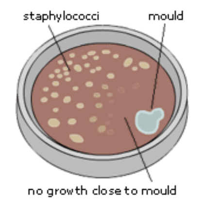{width="100%"}
:::
::::

::: {.notes}
This is the key observation — most scientists would have cursed and thrown away contaminated plates. But Fleming was curious enough to wonder WHY the bacteria died. This is the foundation of every great scientific discovery: curiosity about an unexpected result. Without that curiosity, penicillin would still be sitting in dirty lab dishes unnoticed.
:::

## Question & Hypothesis

**Question:** What killed the bacteria near the mould?

**Hypothesis:** The mould (later identified as *Penicillium*) releases a substance that inhibits bacterial growth.

## Experiment

Fleming:

1. Isolated the mould
2. Extracted its secretions
3. Tested the secretions against various bacteria, including *Staphylococcus*

## Data & Analysis

:::: {.columns}
::: {.column width="50%"}
The substance killed a wide range of bacteria — but was **not toxic to human cells**.

This substance was later named **penicillin**.
:::
::: {.column width="50%"}
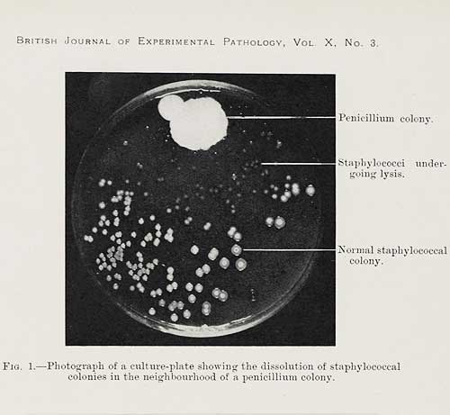{width="100%"}
:::
::::

::: {.notes}
Show them the actual historical 1929 publication photo. This is real data from a real experiment over 90 years ago. The key finding: the mould secretion killed bacteria in a test tube without harming human tissue. This was the data that mattered — not just that bacteria died, but that it could be used safely. The three labels in the photo show: the Penicillium colony (the source), the zone where Staphylococcus is undergoing lysis (dying), and normal Staphylococcus colony far away. This figure was published in the British Journal of Experimental Pathology — Fleming communicated his findings to the scientific community.
:::

## Conclusion & Impact

- Penicillin was recognized as a potential **antibiotic**
- In the 1940s, Howard Florey and Ernst Boris Chain scaled up isolation and production
- This marked the beginning of the **antibiotic era** in medicine

::: {.fragment}
**Estimated lives saved to date: over 200 million**
:::

## Recap

- Science moves through observation → question → hypothesis → experiment → data → analysis → conclusion — as a **cycle**
- A good hypothesis is **testable and falsifiable**
- Distinguish **precision** from **accuracy**
- Control groups, randomization and replication make experiments trustworthy
- Fleming's discovery of penicillin is a real-world example of this whole process

## Classroom Exercise: Exploring the Scientific Method {.smaller}

:::: {.columns}
::: {.column width="40%"}
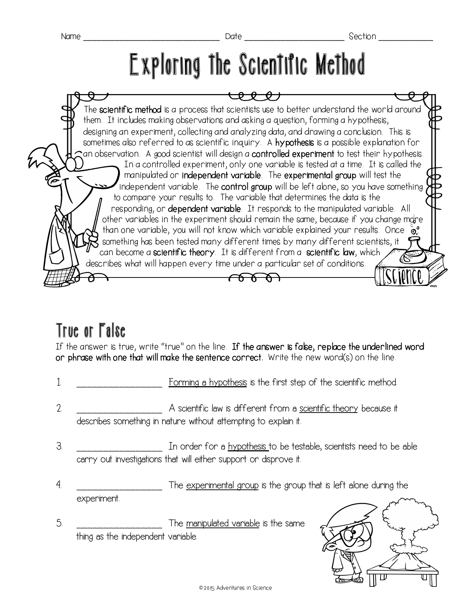{width="100%" fig-align="center"}
:::
::: {.column width="60%"}
Worksheet handed out on paper in class. It covers:

- **True or False** — correct 5 statements about the scientific method
- **Matching** — match 8 terms (hypothesis, control group, independent/dependent variable…) to their definitions
- **Identifying** — read 3 real scenarios and identify the independent variable, dependent variable, experimental group and control group in each
:::
::::

::: {.notes}
Hand out the paper worksheet now and give students time to work through it individually or in pairs. This is a good formative check: the True/False section tests vocabulary, Matching tests definitions, and the three scenarios (dog food, sunscreen, plant growth) test whether students can actually identify variables and groups in a new context, not just recite definitions. Walk around and help, then go through the answers together before the end of class.
:::
