## Warm-up: Review of Session 2 — Live Quiz {.center}

:::: {.columns}
::: {.column width="45%"}

:::
::: {.column width="55%"}
Scan the QR code to join the live quiz on the **Scientific Method** (10 questions).

[Open the quiz](https://forms.gle/jZ4t2N5mUokwetFd9)
:::
::::

::: {.notes}
Every lesson starts with an assessment of the previous class. Display the QR code, run the quiz, then discuss the answers before moving on.
:::

## Session 2 Worksheet: Let's Correct It {.center}

<style>
.reveal .ans { color: #2f6b1f; font-weight: 700; }
.reveal .wrong { color: #c1121f; text-decoration: line-through; }
</style>

:::: {.columns}
::: {.column width="40%"}
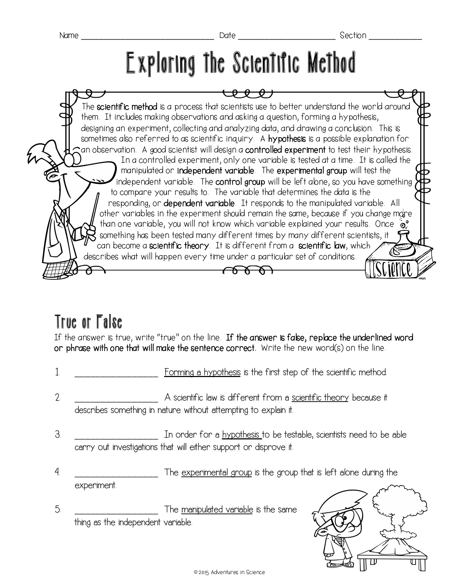{width="100%"}
:::
::: {.column width="60%"}
Take out your worksheet **Exploring the Scientific Method** and a pen of a different colour.

1. **True or False** (1–5)
2. **Matching** (6–13)
3. **Identifying** variables and groups (14–25)
:::
::::

::: {.notes}
Correct the session 2 worksheet together. Students mark their own answers with a different colour pen. For each item, ask a student to say their answer and WHY before revealing it (click to reveal). Answer key from the worksheet's teacher pages.
:::

## Worksheet — True or False {.smaller}

::: {style="font-size: 0.9em;"}
If false, the underlined word is replaced to make the sentence correct.

| # | Statement | Answer |
|---|---|---|
| 1 | *Forming a hypothesis* is the first step of the scientific method. | [False → **making an observation**]{.fragment .ans} |
| 2 | A scientific law is different from a theory because it *describes* something in nature without attempting to explain it. | [True]{.fragment .ans} |
| 3 | For a hypothesis to be testable, scientists must be able to carry out investigations that will either *support or disprove* it. | [True]{.fragment .ans} |
| 4 | The *experimental group* is the group that is left alone during the experiment. | [False → **control group**]{.fragment .ans} |
| 5 | The manipulated variable is the same thing as the *independent variable*. | [True]{.fragment .ans} |

: {tbl-colwidths="[5,70,25]"}
:::

::: {.notes}
1: science starts with an observation, then a question; the hypothesis comes third. 2: a law DESCRIBES what happens (e.g. the law of gravity: objects fall); a theory EXPLAINS why. A theory never "grows up" into a law: they do different jobs. 3: this is falsifiability from Session 2. 4: the control group is left alone, so it gives the baseline. 5: manipulated = independent = the one we change; responding = dependent = the one we measure.
:::

## Worksheet — Matching {.smaller}

::: {style="font-size: 0.92em;"}
| # | Term | Answer |
|---|---|---|
| 6 | Scientific inquiry | [**D** — the many ways in which scientists study the natural world]{.fragment .ans} |
| 7 | Hypothesis | [**E** — a possible answer to a scientific question]{.fragment .ans} |
| 8 | Control group | [**G** — this group is left alone and not experimented on]{.fragment .ans} |
| 9 | Experimental group | [**A** — this group shows the effect of the variable being tested]{.fragment .ans} |
| 10 | Independent variable | [**B** — this is the one variable that is changed]{.fragment .ans} |
| 11 | Dependent variable | [**H** — this is the variable that gets measured]{.fragment .ans} |
| 12 | Scientific theory | [**C** — a well-tested explanation for experimental results]{.fragment .ans} |
| 13 | Scientific law | [**F** — this describes an observed pattern in nature]{.fragment .ans} |

: {tbl-colwidths="[6,28,66]"}
:::

::: {.notes}
The most common mix-ups: control vs experimental group (8–9) and theory vs law (12–13). Theory = explanation (WHY); law = description of a pattern (WHAT happens).
:::

## Worksheet — Identifying {.smaller}

::: {style="font-size: 0.8em;"}
| Scenario | Independent variable | Dependent variable | Experimental group | Control group |
|---|---|---|---|---|
| **Dog food:** 50 dogs get a new diet food, 50 stay on their normal diet; weight checked after a month | [14. the new dog food]{.fragment .ans} | [15. weight lost]{.fragment .ans} | [16. dogs on the new food]{.fragment .ans} | [17. dogs on their normal diet]{.fragment .ans} |
| **Sunscreen:** one arm gets the new formula, the other the leading formula; redness checked after 4 h of sun | [18. the new sunscreen]{.fragment .ans} | [19. redness of the skin]{.fragment .ans} | [20. arm with the new formula]{.fragment .ans} | [21. arm with the leading formula]{.fragment .ans} |
| **Sunlight:** 12 plants get normal sunlight, half of them also stay under bright lamps all night; height after 6 weeks | [22. amount of light]{.fragment .ans} | [23. plant height (growth)]{.fragment .ans} | [24. plants kept under the lamps]{.fragment .ans} | [25. plants with just normal sun]{.fragment .ans} |

: {tbl-colwidths="[32,17,17,17,17]"}
:::

::: {.notes}
Reveal row by row (4 clicks per scenario). Sunscreen is the interesting one: the control is NOT "no sunscreen" but the leading formula, because the question is whether the new one is BETTER than what already exists. Each person is their own control (one arm each), which removes differences between people's skin: a smart design. Ask: what variables must be kept the same in the plant experiment? (water, soil, pot size, type of plant, temperature.)
:::

## DNA: The Molecule of Life {.center}

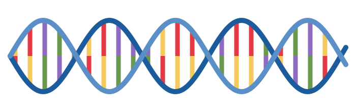{width="80%" fig-align="center" fig-alt="A colourful DNA double helix"}

- The **instruction manual** for every living thing, from bacteria to humans
- Found in almost every cell of your body
- Copied and **passed on** from parents to children

::: {.notes}
Start with a question: "What do you already know about DNA?" Collect a few words on the board (genes, double helix, inheritance, crime scenes…). Then: DNA is not alive and does not "do" anything by itself. It is information, like a recipe book. The cell reads it to build and run the organism.
:::

## What Does "DNA" Stand For?

{width="72%" fig-align="center" fig-alt="The word deoxyribonucleic acid split into deoxy, ribo, nucleic and acid, with the meaning of each part"}

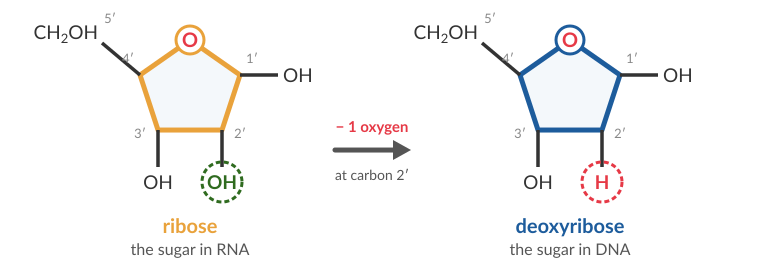{width="62%" fig-align="center" fig-alt="Ribose, the sugar in RNA, has an OH group on carbon 2'; deoxyribose, the sugar in DNA, has only an H there: one oxygen less"}

::: {.notes}
Scientific English tip: long scientific words are often built from smaller parts. If you know the parts, you can decode the word. "De-oxy" = without oxygen (the sugar deoxyribose has one oxygen atom less than ribose, the sugar in RNA). "Nucleic" because Friedrich Miescher first isolated it from cell nuclei in 1869 (he called it "nuclein"). "Acid" because of the phosphate groups. The structures: both sugars have a ring of 4 carbons and 1 oxygen; carbons are numbered 1′ to 5′ ("one prime" to "five prime"). The only difference is carbon 2′: OH in ribose, just H in deoxyribose. Students do not need to memorise the structures, only the idea "deoxy = one oxygen missing". (The 5′ and 1′ carbons are where the phosphate and the base attach in a nucleotide: next slide.) Ask: what could "ribonucleic acid" (RNA) mean?
:::

## The Building Block: the Nucleotide

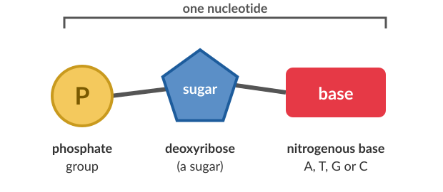{width="80%" fig-align="center" fig-alt="A nucleotide: a phosphate group linked to a deoxyribose sugar, linked to a nitrogenous base"}

DNA is a **polymer**: a long chain of millions of nucleotides.

::: {.vocab-box}
**Vocabulary:** *polymer* — a large molecule made of many repeated units (*poly* = many, *mer* = part).
:::

::: {.notes}
Every nucleotide has the same phosphate and the same sugar. Only the base changes, and there are only four kinds. So all the information in DNA is in the ORDER of the bases, the way all the information in a book is in the order of the letters.
:::

## Four Bases, Two Families

{width="72%" fig-align="center" fig-alt="Purines adenine and guanine have two rings; pyrimidines cytosine and thymine have one ring"}

::: {.notes}
Purines (A, G) are bigger: two rings. Pyrimidines (C, T) are smaller: one ring. In RNA, thymine is replaced by uracil (U), another pyrimidine. Mnemonics: "Pure As Gold" for purines; "CUT the Py" for pyrimidines. Students do not need to learn the chemical structures, only the two families and which base belongs to which.
:::

## The Base-Pairing Rule

{width="75%" fig-align="center" fig-alt="A pairs with T through 2 hydrogen bonds; G pairs with C through 3 hydrogen bonds; each pair has the same width"}

**A** always pairs with **T**, **G** always pairs with **C**. The two strands are **complementary**.

::: {.notes}
A purine always pairs with a pyrimidine, so every rung of the ladder has the same width and the helix is regular. Hydrogen bonds are weak, so the two strands can be separated ("unzipped") without breaking the strands themselves. That will matter for replication. G–C pairs have three bonds, so DNA rich in G and C is harder to separate (it melts at a higher temperature).
:::

## Complementary Strands — Try It

If one strand reads:

<p style="font-family: monospace; font-size: 1.3em; text-align:center;">A T G C C T A G G A</p>

What does the other strand read?

::: {.fragment}
<p style="font-family: monospace; font-size: 1.3em; text-align:center; color:#e63946;">T A C G G A T C C T</p>

If you know **one** strand, you know **both**. That is why DNA can be copied.
:::

::: {.notes}
Give students 30 seconds, then reveal. Optional extra: ask them to write their own 8-letter strand and swap with a neighbour, who writes the complementary strand. Advanced point if someone asks: the two strands run in opposite directions (antiparallel), labelled 5' and 3'.
:::

## The Double Helix

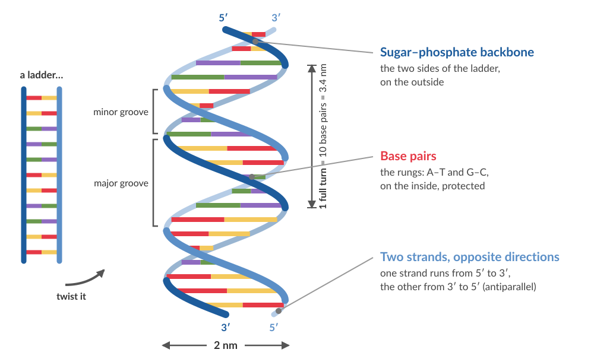{width="100%" fig-align="center" fig-alt="A ladder with coloured rungs is twisted into a double helix. Labels: the sugar-phosphate backbone forms the two sides, on the outside; the base pairs A-T and G-C are the rungs, on the inside; the two strands run in opposite directions, 5' to 3' and 3' to 5'; the helix is 2 nm wide; one full turn is 10 base pairs, 3.4 nm; the twist creates a minor groove and a major groove."}

::: {.notes}
Focus on the SHAPE, not the chemistry. Start from the ladder: two sides (sugar–phosphate backbones) and rungs (base pairs). Then twist it. Points to make: (1) the backbone is on the outside and the bases, which carry the information, are on the inside, where they are protected; (2) every rung has the same width (purine + pyrimidine), so the helix is perfectly regular: 2 nm wide, one full turn every 10 base pairs (3.4 nm); (3) the two strands run in opposite directions, labelled 5′ and 3′ after the numbered carbons of the sugar (slide 8); (4) the strands are not exactly opposite each other, so the twist leaves a wide groove and a narrow groove (major and minor grooves). Proteins that read DNA, for example the ones that switch genes on and off, fit into the major groove and "feel" the bases without opening the helix. Who discovered this shape, and how? We will see it in the case study at the end of the lesson.
:::

## Why 5' and 3'?

<div style="text-align:center; line-height:0;">
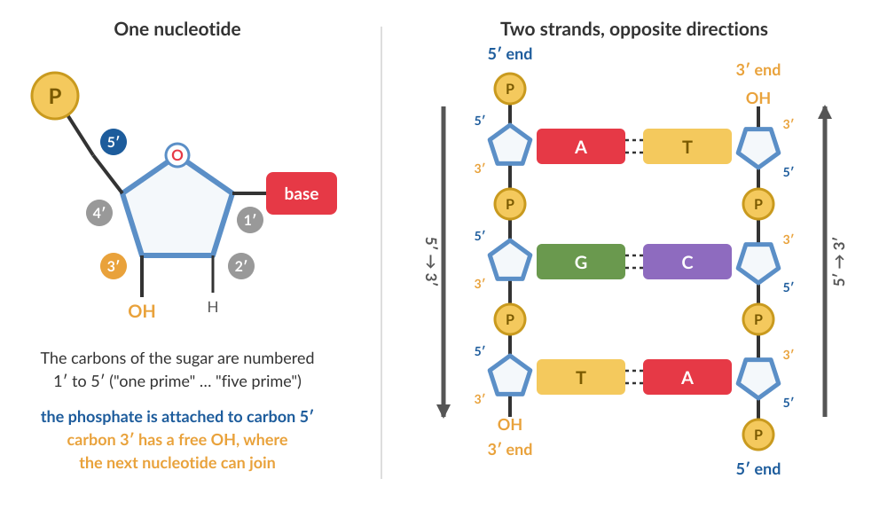
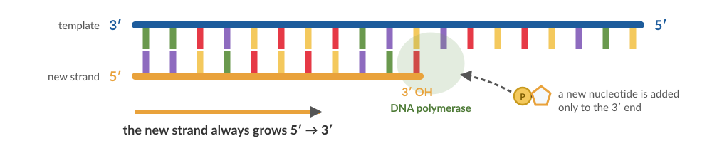
</div>

::: {.notes}
The names come from the sugar (see slide 8). Its five carbon atoms are numbered 1′ to 5′. The prime sign (′) is there because the atoms of the base are also numbered (1, 2, 3…), so the sugar's carbons get a prime to tell them apart. Read "5′" as "five prime". In a strand, each phosphate is a bridge: it is attached to carbon 5′ of one sugar and carbon 3′ of the next sugar. So the strand has a direction, like an arrow: at one end there is a free phosphate on a 5′ carbon (the 5′ end), at the other end a free OH on a 3′ carbon (the 3′ end). Scientists always write DNA sequences from 5′ to 3′. Point at the pentagons: on the left strand they point up, on the right strand they are upside down, so the two strands are antiparallel. This is why base pairs fit neatly in the middle. Replication direction (bottom strip): DNA polymerase can only add a new nucleotide to the free OH on the 3′ end of the growing strand. The new nucleotide arrives with its phosphate on the 5′ side, and that phosphate bonds to the 3′ OH. So a new strand always grows 5′ → 3′, reading the template in the opposite direction (3′ → 5′). Because the two template strands are antiparallel, one new strand can be made continuously while the other is made in short pieces (Okazaki fragments) that are joined later: mention only if students ask, or link to the Amoeba Sisters video coming up. Ask: if one strand reads 5′-ATG-3′, how do you write its partner in the 5′ → 3′ direction? (5′-CAT-3′.)
:::

## How Small Is DNA?

<div style="text-align:center; line-height:0;">

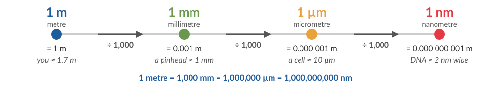
</div>

::: {style="font-size:0.85em; text-align:center; margin-top:12px;"}
The helix is only **2 nm** wide, but the DNA in **one** cell, unwound, is about **2 m** long!
:::

::: {.notes}
Use the scale: each step to the right is 1,000 times smaller. Milli = one thousandth, micro = one millionth, nano = one billionth (the same prefixes as in milligram, microsecond, nanotechnology). Ask: how many nanometres in a millimetre? (1,000,000.) 2 nm = 0.000002 mm: about 50,000 times thinner than a human hair. You cannot see a single DNA molecule with a light microscope. And yet each cell nucleus (about 6 µm across) holds about 2 m of DNA. How does it fit? Next slide. Next week, in the lab, you will extract DNA from fruit and see it with your own eyes: you will see millions of molecules clumped together, not a single one.
:::

## Estimate It: All the DNA in Your Body

::: {.callout-tip}
**A scientist's estimate:** about **2 m** of DNA per cell × your number of cells = ?
:::

1. Guess the number of cells in a human body
2. Multiply by 2 m
3. Compare with the distance from the Earth to the Sun: **150 million km**

::: {.fragment}
≈ 30 trillion cells × 2 m ≈ **60 billion km**: enough to go to the Sun and back **about 200 times**.
:::

::: {.notes}
This is a "Fermi estimate": a rough calculation with round numbers, the way scientists check if an answer is reasonable. Let groups of students try it before revealing. Numbers: about 30 trillion (3 × 10^13) cells in a human body (Sender et al., 2016). 3 × 10^13 × 2 m = 6 × 10^13 m = 6 × 10^10 km. Sun and back = 3 × 10^8 km, so 6 × 10^10 / 3 × 10^8 = 200 trips. Critical-thinking twist (link to Session 2): this estimate has a hidden assumption! About 80% of our cells are red blood cells, and they have NO nucleus and no DNA. So the real answer is several times smaller, but still tens of round trips to the Sun. Popular websites quote very different numbers ("600 times to the Sun", "17 times to Pluto") because they make different assumptions. Ask: which assumptions would change the answer?
:::

## Packing DNA: Chromosomes

:::: {.columns}
::: {.column width="50%"}
{width="100%"}
:::
::: {.column width="50%"}
- DNA is wound around proteins called **histones**, like thread on a spool
- It is then coiled again and again into **chromosomes**
- Humans have **46 chromosomes** (23 pairs): one set from each parent
:::
::::

::: {.notes}
The packaging is what lets 2 m of DNA fit into a nucleus a few micrometres wide. DNA + histones = chromatin. Before a cell divides, chromatin condenses into the X-shaped chromosomes you see in textbook pictures.
:::

## Where Is DNA Found?

:::: {.columns}
::: {.column width="50%"}
{width="100%"}
:::
::: {.column width="50%"}
- Mostly in the **nucleus**
- A little in the **mitochondria**
- In plants, also in the **chloroplasts**
- Bacteria have no nucleus: their DNA floats in the cell
:::
::::

::: {.notes}
Mitochondria and chloroplasts have their own small DNA because they were once free-living bacteria swallowed by an ancestral cell (endosymbiosis). Mitochondrial DNA is inherited only from the mother, which is useful for tracing ancestry. We will meet this again in the forensic DNA session.
:::

## DNA Replication: Copying the Code

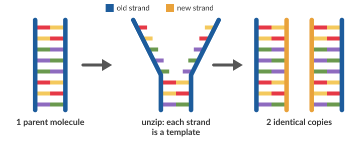{width="82%" fig-align="center" fig-alt="A parent DNA molecule unzips; each old strand is a template for a new strand, giving two identical copies, each with one old and one new strand"}

The helix **unzips** → each strand is a **template** → new bases follow the pairing rule → **two identical copies**

::: {.notes}
Before every cell division, all 3 billion base pairs are copied. Each new molecule keeps one old strand and gets one new strand: this is called semi-conservative replication. The enzyme that unzips is helicase; the enzyme that adds new nucleotides is DNA polymerase. It makes about one mistake in a billion bases after proofreading. Those rare mistakes are mutations.
:::

## DNA Replication: Video



::: {.notes}
Amoeba Sisters, "DNA Replication". Play it, then ask: what does helicase do? What does DNA polymerase do? Why is the pairing rule essential for copying?
:::

## What Is a Gene?

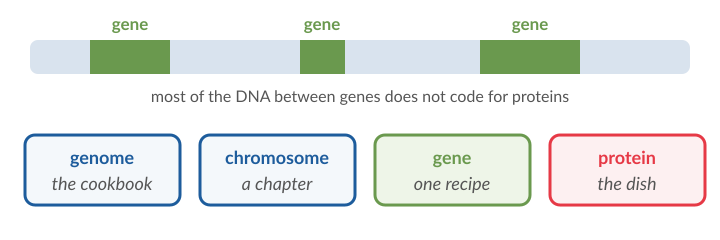{width="85%" fig-align="center" fig-alt="A long DNA molecule with a few short coloured segments labelled gene; analogy: genome is a cookbook, chromosome a chapter, gene a recipe, protein the dish"}

A **gene** is a stretch of DNA with the instructions to make **one product**, usually a **protein**.

::: {.notes}
Proteins do most of the work in a cell: enzymes, hormones like insulin, antibodies, the keratin in your hair. How the cell reads a gene to make a protein (DNA → RNA → protein) is the topic of Session 5, the "central dogma". Every cell has the same DNA (same cookbook), but a liver cell and a brain cell read different recipes.
:::

## The Human Genome by Numbers — Guess First!

<style>
.reveal .opt { display: inline-block; padding: 0 0.3em; margin: 0 0.1em; border-radius: 4px; }
.reveal .fragment.custom.correct.visible { background: #6a994e; color: #fff; font-weight: 700; }
</style>

Choose an answer for each question, then check.

::: {style="font-size: 0.72em;"}
| Question | Answer |
|---|---|
| How many base pairs are in the human genome? | [3 million]{.opt} · [3 billion]{.opt .fragment .custom .correct fragment-index=1} · [3 trillion]{.opt} |
| How many protein-coding genes? | [2,000]{.opt} · [20,000]{.opt .fragment .custom .correct fragment-index=2} · [200,000]{.opt} |
| What fraction of the genome codes for proteins? | [1.5 %]{.opt .fragment .custom .correct fragment-index=3} · [15 %]{.opt} · [50 %]{.opt} |
| Typing it at 60 words per minute, 8 hours a day: how long? | [6 months]{.opt} · [6 years]{.opt} · [60 years]{.opt .fragment .custom .correct fragment-index=5} |
| How much of your DNA is unique to you? | [0.1 %]{.opt .fragment .custom .correct fragment-index=6} · [1 %]{.opt} · [10 %]{.opt} |
:::

::: {.fragment .fade-in-then-out fragment-index=4 style="position:absolute; top:95px; left:30px; width:990px; background:#fff; border:3px solid #1d5c9c; border-radius:16px; box-shadow:0 10px 30px rgba(0,0,0,0.25); padding:14px 18px; z-index:10;"}
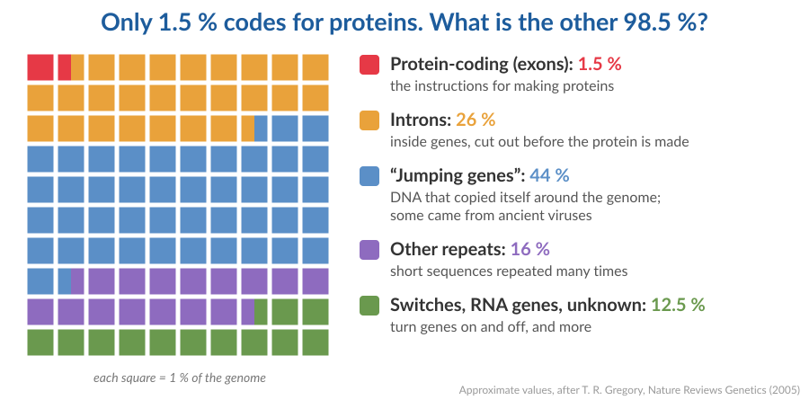{width="100%" fig-alt="A grid of 100 squares, each 1% of the human genome: 1.5% protein-coding exons; 26% introns, inside genes but cut out before the protein is made; 44% jumping genes (transposable elements), some from ancient viruses; 16% other repeated sequences; 12.5% switches that turn genes on and off, RNA genes and unknown."}
:::

::: {.notes}
Students guess on paper first (retrieval and prediction from Session 1!), then reveal answers one at a time. Typing: 3.1 billion letters; 60 words per minute ≈ 300 letters per minute; 8 h a day = 144,000 letters a day; 3.1 billion / 144,000 ≈ 21,500 days ≈ 59 years. The 1.5% refers to the parts of genes that are actually translated into protein (exons). The click after the 1.5% answer opens a pop-up with the rest of the genome; the next click closes it and reveals the typing question. Pop-up: introns (26%) are inside genes but cut out of the message before the protein is made; "jumping genes" (transposable elements, 44%) are pieces of DNA that copied and pasted themselves around the genome over millions of years, and about 8% of our genome comes from ancient viruses that infected our ancestors; other repeats (16%) are short sequences repeated many times, for example around the centromeres; the remaining part includes the switches (promoters, enhancers) that turn genes on and off, genes for RNA molecules that are not translated into proteins, and DNA whose function is still unknown. It used to be called "junk DNA", but that name is misleading: some of it has important jobs, although scientists still debate how much is really functional. On the "0.1%": two people differ at about 1 base in 1,000 (single-letter differences). Counting larger insertions and deletions too, the difference is somewhat bigger (around 0.5%), but 0.1% is the figure usually quoted.
:::

## Is the Human at the Top?

:::: {.columns}
::: {.column width="77%"}
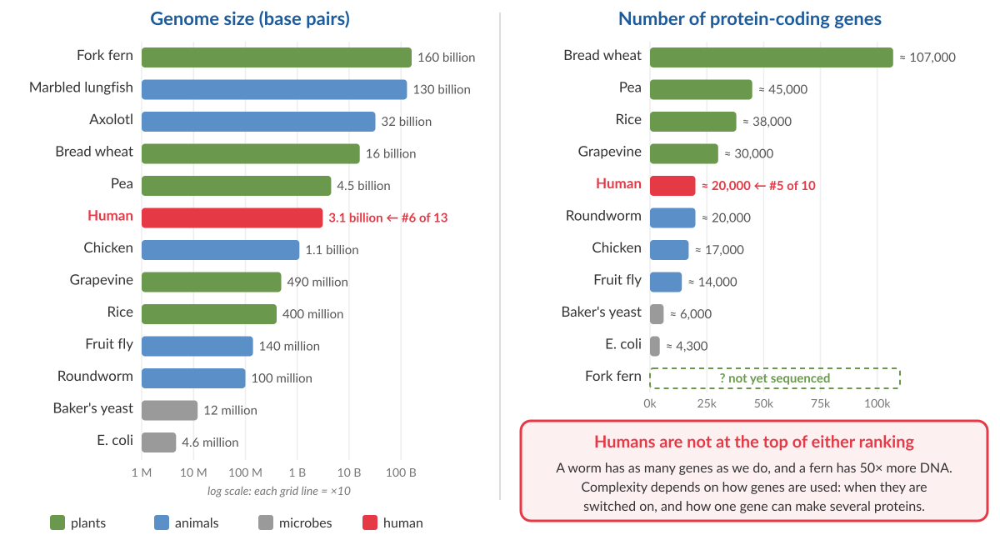{width="100%" fig-alt="Two ranked bar charts. Genome size: fork fern 160 billion base pairs, marbled lungfish 130 billion, axolotl 32 billion, bread wheat 16 billion, pea 4.5 billion, human 3.1 billion (6th of 13), down to E. coli 4.6 million. Protein-coding genes: bread wheat 107,000, pea 45,000, rice 38,000, grapevine 30,000, human 20,000 (5th of 10), roundworm 20,000, down to E. coli 4,300."}
:::
::: {.column width="23%"}
<div style="text-align:center; font-size:16px; line-height:1.25; margin-top:20px;">
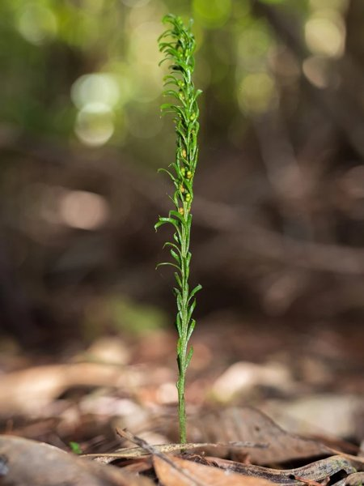
<div style="margin:4px 0 14px;"><b>Fork fern</b><br>the biggest genome known</div>
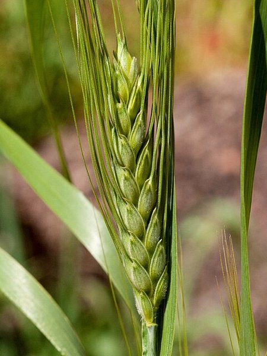
<div style="margin:4px 0 10px;"><b>Bread wheat</b><br>≈ 107,000 genes</div>
<div style="font-size:10px; color:#888;">Photos: Pol Fernández (CC BY 4.0); Patrick Alexander (CC0), via Wikimedia Commons</div>
</div>
:::
::::

::: {.notes}
The photos: the fork fern Tmesipteris oblanceolata is a small plant, only 10–15 cm tall, that grows on tree trunks in New Caledonia, yet each of its cells holds about 100 m of DNA. Bread wheat (Triticum aestivum) is the wheat in our bread and pasta flour. Before showing the chart, ask: "Which organism do you think has the biggest genome? The most genes?" Most students will say humans. Then reveal. Genome size: the fork fern Tmesipteris oblanceolata (New Caledonia) holds the record, ≈ 160 billion base pairs, about 50 times ours (Fernández et al., 2024). Marbled lungfish ≈ 130 billion; axolotl ≈ 32 billion; bread wheat ≈ 16 billion (it has six copies of its genome, from three ancestral species). Gene counts: the fork fern has a "?" because its genome has only been weighed (measured by flow cytometry), never sequenced, so nobody knows how many genes it has. Bread wheat ≈ 107,000 (IWGSC, 2018), pea ≈ 45,000 (Kreplak et al., 2019), and the roundworm C. elegans, a 1 mm worm with about 1,000 cells, has about the same number of genes as us. This puzzle has a name: the "C-value paradox" (genome size does not match complexity). Why so much DNA? Large genomes are mostly filled with repeated sequences, and many plants have duplicated their whole genome during evolution. How do humans get complexity with only 20,000 genes? By controlling when and where genes are switched on, and by making several different proteins from one gene (alternative splicing, Session 5). Link to Session 2: the "hypothesis" that more genes means a more complex organism was tested by sequencing, and the data contradicted it. Numbers are rounded; different sources give slightly different values.
:::

## Mutations: Changes to the Code

{width="80%" fig-align="center" fig-alt="Sentence analogy: THE CAT ATE THE RAT; a substitution gives THE CAT ATE THE HAT; a deletion shifts the letters and garbles the rest"}

A **mutation** is a change in the DNA sequence. Its effect can be **harmful**, **neutral** or **beneficial**.

::: {.notes}
The cell reads DNA in three-letter "words" (codons), so the sentence analogy works well. A substitution changes one word; a deletion or insertion shifts the reading frame and garbles everything after it, so it is usually more harmful. Most mutations are neutral: they fall outside genes, or do not change the protein. Real example of "harmful AND beneficial": the sickle-cell mutation (one letter, A → T) causes sickle-cell disease if you inherit two copies, but one copy protects against malaria. Mutations are the raw material of evolution: without them there would be no variation. Causes: copying errors during replication, UV light, some chemicals, radiation.
:::

## How Much DNA Do We Share?

- With **any other human**: about **99.9 %**
- With a **chimpanzee**: about **99 %**
- With a **mouse**: about **85 %** of the protein-coding DNA
- With a **fruit fly**: about **60 %** of our genes have a fly version

::: {.callout-warning}
"You share 50 % of your DNA with a banana" is a popular claim. It really means many of our **genes** have a related version in plants. It does **not** mean half of your DNA letters are the same!
:::

::: {.notes}
These similarities are strong evidence that all living things share common ancestors: the more distantly related, the less similar the DNA. Critical-thinking link to Session 2: always ask WHAT is being compared (whole genome? only genes? only protein-coding parts?) and HOW similarity is measured. Different methods give very different percentages for the same pair of species. Fruit flies are used in medical research because about 75% of human disease-related genes have a counterpart in the fly.
:::

## Every Person Is Unique

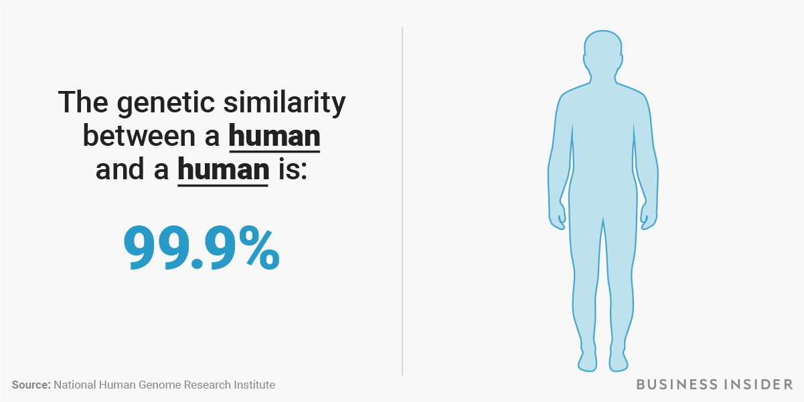{width="65%" fig-align="center"}

0.1 % of 3 billion = **3 million** differences between you and the person next to you.

::: {.notes}
0.1% sounds tiny, but 0.1% of 3 billion is 3 million letters. These differences contribute to eye colour, height, risk of some diseases, and so on. They are also what forensic DNA testing uses to identify people (Session 8). Except for identical twins, everyone's DNA is unique.
:::

# Case Study: The Double Helix {background-color="#1d5c9c"}

## Background: What Was Known

:::: {.columns}
::: {.column width="38%"}
- 1944: **DNA** is shown to carry genetic information
- 1950: Erwin **Chargaff** measures the four bases in many species
- Nobody knows the **shape** of the molecule
:::
::: {.column width="62%"}
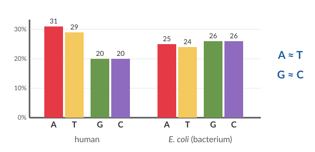{width="100%" fig-alt="Bar chart: in human DNA A is 31%, T 29%, G 20%, C 20%; in E. coli A 25%, T 24%, G 26%, C 26%"}
:::
::::

::: {.notes}
Observation step of the scientific method. Ask students: what pattern do you see in the data? Answer: in every species, the amount of A is about equal to T, and G is about equal to C, but the A+T vs G+C ratio changes from species to species. These are "Chargaff's rules". Chargaff did not know WHY. Values are approximate (Chargaff's data, rounded). The 1944 experiments were by Avery, MacLeod and McCarty.
:::

## The Data: Photo 51

:::: {.columns}
::: {.column width="45%"}
{width="100%"}
:::
::: {.column width="55%"}
- May 1952, King's College London
- **Rosalind Franklin** and her student Raymond Gosling shoot X-rays through DNA fibres
- The **X-shaped** pattern means a **helix**; the spacing gives its size
:::
::::

::: {.notes}
Data collection step. Franklin was an expert in X-ray crystallography: X-rays are scattered by the molecule and the pattern on film reveals its structure. Photo 51 needed about 100 hours of exposure. From her images and measurements Franklin worked out that the backbone is on the outside and that the molecule has a regular repeating structure. Precision link to Session 2: her measurements were careful and repeated.
:::

## Reading Photo 51

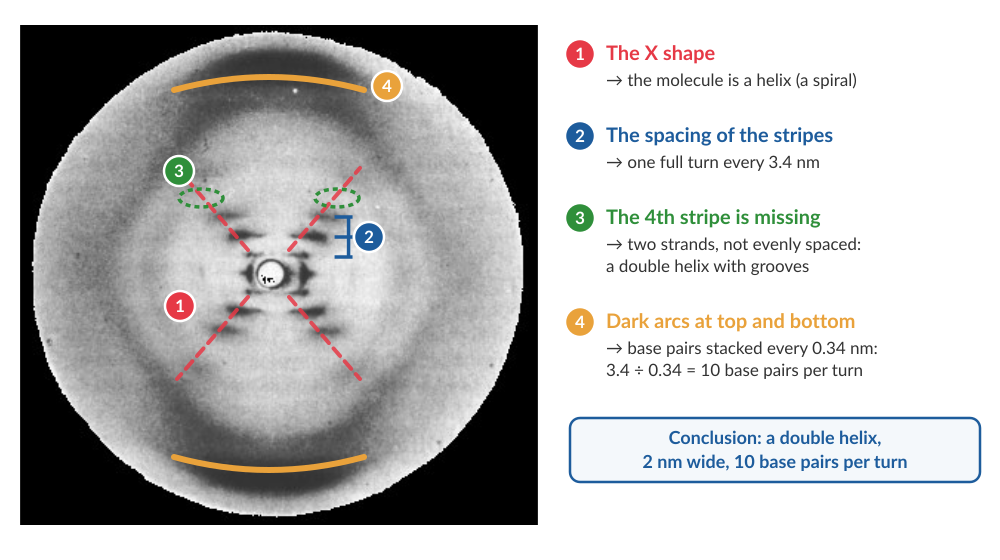{width="100%" fig-align="center" fig-alt="Photo 51 with four clues marked: 1, the X shape means a helix; 2, the spacing of the stripes along the X means one full turn every 3.4 nm; 3, the fourth stripe is missing, meaning two strands that are not evenly spaced, a double helix with grooves; 4, dark arcs at top and bottom mean base pairs stacked every 0.34 nm, so 10 base pairs per turn. Conclusion: a double helix, 2 nm wide, 10 base pairs per turn."}

::: {.notes}
Data analysis step of the scientific method: how do you get a 3D shape from a 2D photo? X-rays bounce off the regularly repeating parts of the molecule and make a pattern of dark spots on the film. Reveal the clues one at a time and let students guess what each means. (1) The X: a zigzag seen from the side gives an X-shaped pattern, and a helix seen from the side looks like a zigzag, so the X means a helix. The steeper the X, the flatter the coils. (2) The stripes (layer lines) along the arms of the X: their spacing tells you how long one full turn is, 3.4 nm. Counter-intuitive but important: the CLOSER the stripes on the film, the LONGER the repeat in the molecule (diffraction works "upside down", like the reciprocal). (3) The 4th stripe is missing: with a single helix it would be there. It disappears because there are two strands, shifted by about 3/8 of a turn, so their signals cancel at that position. Two strands that are not opposite each other means a major and a minor groove (slide 13). (4) The strong arcs at the very top and bottom: something repeats every 0.34 nm along the molecule: the flat base pairs stacked like a pile of coins. 3.4 nm ÷ 0.34 nm = 10 base pairs per turn. The width (about 2 nm) comes from the spacing of the spots across the pattern. Franklin also showed, from how DNA takes up water, that the phosphate backbone must be on the outside. Watson recalled that when he saw Photo 51 "my mouth fell open and my pulse began to race": the X told him immediately it was a helix.
:::

## From Photo 51 to the Double Helix

```{=html}
<div style="display:flex; gap:22px; align-items:center; justify-content:center; margin-top:0;">
<canvas id="p51c" style="width:520px; height:520px;"></canvas>
<div style="width:460px;">
<ol id="p51steps" style="margin:0; padding-left:1.3em; font-size:27px; line-height:1.3;">
<li>Photo 51: the X-ray pattern of DNA</li>
<li>Find the <b>X</b></li>
<li>Turn each arm 90°: the slopes of a <b>zigzag</b></li>
<li>A <b>helix</b> seen from the side looks like a zigzag</li>
<li>Missing 4th stripe → a <b>second strand</b>, shifted</li>
<li>Arcs top and bottom → <b>10 base pairs</b> per turn</li>
</ol>
<div style="margin-top:22px; display:flex; gap:10px;">
<button id="p51play" style="font-size:22px; padding:6px 16px; border-radius:8px; border:2px solid #1d5c9c; background:#1d5c9c; color:#fff; cursor:pointer;">⏸ Pause</button>
<button id="p51step" style="font-size:22px; padding:6px 16px; border-radius:8px; border:2px solid #1d5c9c; background:#fff; color:#1d5c9c; cursor:pointer;">Step ▸</button>
<button id="p51reset" style="font-size:22px; padding:6px 16px; border-radius:8px; border:2px solid #999; background:#fff; color:#555; cursor:pointer;">↺ Restart</button>
</div>
</div>
</div>
<script>
(function(){
  const cv=document.getElementById('p51c'); if(!cv) return;
  const S=500, dpr=2; cv.width=S*dpr; cv.height=S*dpr;
  const ctx=cv.getContext('2d'); ctx.scale(dpr,dpr);
  const img=new Image(); img.src='img/slide08_img0.png';
  const B=[0,1.5,3.8,6.4,9.0,11.6,14.0,16.6];          // stage start times (s)
  const cx=250, cy=250, A=78, P=3.48*78, y0=36, y1=464, R=205;
  const ARM=49*Math.PI/180;
  const col={A:'#e63946',T:'#f4c95d',G:'#6a994e',C:'#8e6bbf'}, pr={A:'T',T:'A',G:'C',C:'G'};
  const seq='ATGCGTACCGATTGCAAGTCGATGCATTGC';
  let T=0, playing=false, target=null, last=null;
  const sm=x=>x<=0?0:x>=1?1:x*x*(3-2*x);
  const prog=i=>sm((T-B[i])/(B[i+1]-B[i]));
  const tri=th=>(2/Math.PI)*Math.asin(Math.sin(th));
  function hex(c){return [1,3,5].map(i=>parseInt(c.substr(i,2),16));}
  function mix(a,b,t){const x=hex(a),y=hex(b);return 'rgb('+x.map((v,i)=>Math.round(v+(y[i]-v)*t)).join(',')+')';}
  function stage(){let s=0;for(let i=0;i<B.length;i++) if(T>=B[i]) s=i; return Math.min(s,6);}
  function arrow(x1,y1,x2,y2){ctx.beginPath();ctx.moveTo(x1,y1);ctx.lineTo(x2,y2);ctx.stroke();
    for(const [px,py,qx,qy] of [[x1,y1,x2,y2],[x2,y2,x1,y1]]){const a=Math.atan2(qy-py,qx-px);
      ctx.beginPath();ctx.moveTo(px,py);ctx.lineTo(px+10*Math.cos(a+0.45),py+10*Math.sin(a+0.45));
      ctx.lineTo(px+10*Math.cos(a-0.45),py+10*Math.sin(a-0.45));ctx.closePath();ctx.fill();}}
  function draw(){
    ctx.clearRect(0,0,S,S);
    // 1. photo
    const pa=1-0.85*prog(2)-0.15*prog(3);
    if(img.complete && pa>0.01){ctx.globalAlpha=pa; ctx.drawImage(img,25,30,450,435); ctx.globalAlpha=1;}
    // 2-3. the X, then rotate its arms by 90 degrees
    const xa=1-prog(3);
    if(prog(1)>0 && xa>0.01){
      const L=R*prog(1), rot=prog(2)*Math.PI/2;
      ctx.strokeStyle='#e63946'; ctx.lineWidth=5; ctx.lineCap='round'; ctx.globalAlpha=xa;
      for(const a of [ARM,-ARM]){const b=a+rot;
        ctx.beginPath(); ctx.moveTo(cx-L*Math.cos(b),cy+L*Math.sin(b)); ctx.lineTo(cx+L*Math.cos(b),cy-L*Math.sin(b)); ctx.stroke();}
      ctx.globalAlpha=1;
    }
    // 4-7. zigzag -> helix -> double helix -> base pairs
    const rv=prog(3); if(rv<=0) return;
    const m=prog(4), sh=prog(4), s2=prog(5), rg=prog(6);
    const phi=Math.max(0,T-(B[4]+1.3))*1.1;
    const half=rv*(y1-y0)/2;
    const X=(y,off)=>{const th=2*Math.PI*(y-cy)/P+off+phi; return cx+A*((1-m)*tri(th)+m*Math.sin(th));};
    const Z=(y,off)=>Math.cos(2*Math.PI*(y-cy)/P+off+phi);
    const off2=0.70*Math.PI;
    const c1=mix('#e63946','#1d5c9c',m), c2='#5b8fc7';
    function strand(off,color,alpha,front){
      if(alpha<=0.01) return;
      ctx.strokeStyle=color; ctx.lineCap='round';
      for(let y=cy-half; y<cy+half; y+=2){
        const y2=Math.min(y+2.5,cy+half), z=Z(y+1,off), isFront=z>=0;
        if(sh>0.01 && isFront!==front) continue;
        if(sh<=0.01 && !front) continue;
        ctx.globalAlpha=alpha*(isFront||sh<=0.01?1:1-0.6*sh);
        ctx.lineWidth=isFront||sh<=0.01?9:7;
        ctx.beginPath(); ctx.moveTo(X(y,off),y); ctx.lineTo(X(y2,off),y2); ctx.stroke();
      }
      ctx.globalAlpha=1;
    }
    strand(0,c1,1,false); strand(off2,c2,s2,false);
    if(rg>0.01 && s2>0.5){
      ctx.lineCap='butt'; ctx.lineWidth=7;
      let k=0;
      for(let y=cy-Math.floor(half/(P/10))*(P/10); y<=cy+half; y+=P/10, k++){
        const a=X(y,0), b=X(y,off2); if(Math.abs(a-b)<6) continue;
        const base=seq[k%seq.length], mid=(a+b)/2; ctx.globalAlpha=rg;
        ctx.strokeStyle=col[base]; ctx.beginPath(); ctx.moveTo(a,y); ctx.lineTo(mid,y); ctx.stroke();
        ctx.strokeStyle=col[pr[base]]; ctx.beginPath(); ctx.moveTo(mid,y); ctx.lineTo(b,y); ctx.stroke();
      }
      ctx.globalAlpha=1;
    }
    strand(0,c1,1,true); strand(off2,c2,s2,true);
    if(rg>0.01){
      ctx.globalAlpha=rg; ctx.strokeStyle='#555'; ctx.fillStyle='#555'; ctx.lineWidth=2;
      arrow(cx-A,y1+18,cx+A,y1+18);
      ctx.font='bold 17px Lato, Helvetica, Arial, sans-serif'; ctx.textAlign='center';
      ctx.fillStyle='#fff'; ctx.fillRect(cx-28,y1+7,56,22); ctx.fillStyle='#333'; ctx.fillText('2 nm',cx,y1+24);
      const tx=cx+A+40, ta=cy-P/2, tb=cy+P/2; ctx.fillStyle='#555'; arrow(tx,ta,tx,tb);
      ctx.save(); ctx.translate(tx+18,cy); ctx.rotate(-Math.PI/2); ctx.fillStyle='#333';
      ctx.fillText('1 turn = 3.4 nm = 10 base pairs',0,0); ctx.restore();
      ctx.globalAlpha=1;
    }
  }
  const lis=[...document.querySelectorAll('#p51steps li')];
  const playBtn=document.getElementById('p51play');
  const MAP=[0,1,2,2,3,4,5];
  function ui(){const s=MAP[stage()];
    lis.forEach((li,i)=>{li.style.color=i<s?'#333':i===s?'#1d5c9c':'#aaa'; li.style.fontWeight=i===s?'700':'400';});
    playBtn.textContent=playing?'⏸ Pause':'▶ Play';}
  function tick(ts){
    if(last===null) last=ts; const dt=Math.min(0.05,(ts-last)/1000); last=ts;
    if(playing){T+=dt; if(target!==null && T>=target){T=target; playing=false; target=null;}}
    else if(T>=B[7] && dbg===null) T+=dt;   // keep the finished helix turning
    draw(); ui(); requestAnimationFrame(tick);
  }
  playBtn.onclick=()=>{ if(T>=B[7]){T=0;} playing=!playing; target=null; };
  document.getElementById('p51step').onclick=()=>{ const s=stage(); if(T<B[7]){target=B[Math.min(s+1,7)]; playing=true;} };
  document.getElementById('p51reset').onclick=()=>{ T=0; playing=false; target=null; };
  function onSlide(e){ if(e.currentSlide && e.currentSlide.contains(cv)){T=0; target=null; playing=true;} else playing=false; }
  const dbg=new URLSearchParams(location.search).get('p51t');
  function hook(){
    if(!window.Reveal) return;
    Reveal.on('slidechanged',onSlide); Reveal.on('ready',onSlide);
    const cur=Reveal.getCurrentSlide && Reveal.getCurrentSlide();
    if(cur) onSlide({currentSlide:cur});
    if(dbg!==null){T=+dbg; playing=false;}
  }
  if(document.readyState==='complete') hook(); else window.addEventListener('load',hook);
  img.onload=()=>draw();
  requestAnimationFrame(tick);
})();
</script>
```

::: {.notes}
An animation of the reasoning on the previous slide. It starts by itself when the slide appears; use "Step ▸" to stop after each stage and ask the class what comes next, or "Pause"/"Restart". Stages: (1) Photo 51. (2) The X. (3) Physics of diffraction: each arm of the X is at right angles to a repeating slope in the molecule, so turning each arm by 90° gives the two slopes of a zigzag. (4) A helix seen from the side IS a zigzag (smoothed into a wave): watch it start to turn in 3D. (5) The missing 4th stripe means a second strand, shifted about 3/8 of a turn, which creates the major and minor grooves. (6) The arcs at the top and bottom of the photo give the 0.34 nm spacing of the stacked base pairs: 10 per turn of 3.4 nm; the width is 2 nm. This is a simplified explanation for students: real X-ray diffraction analysis is mathematical, but the logic is the same.
:::

## The Hypothesis: Building Models

:::: {.columns}
::: {.column width="55%"}
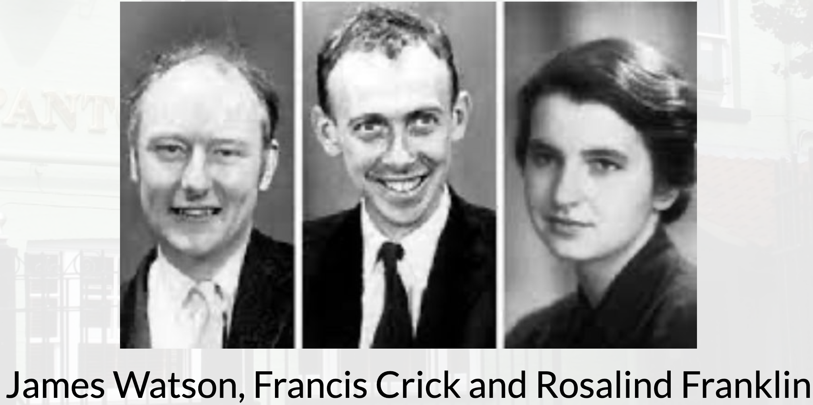{width="100%"}
:::
::: {.column width="45%"}
In Cambridge, **James Watson** and **Francis Crick** build models of metal and cardboard.

Their **first model (1951) was wrong**: bases on the outside, three strands.
:::
::::

::: {.notes}
Hypothesis step. Watson and Crick did not do experiments themselves: they combined other people's data into a model, and tested whether the model fitted ALL the data. Their first model was rejected after Franklin pointed out that it contradicted her measurements. Science is a cycle: back to the drawing board! In January 1953, Maurice Wilkins (Franklin's colleague) showed Photo 51 to Watson without Franklin's knowledge, and Watson and Crick also saw a report with her data. This is an important ethics discussion point for the end of the case study.
:::

## "We Have Found the Secret of Life"

:::: {.columns}
::: {.column width="50%"}
{width="100%"}
:::
::: {.column width="50%"}
- **28 February 1953**: the new model fits Photo 51 **and** Chargaff's rules
- Crick announces it at lunch in the **Eagle pub**, Cambridge
- **April 1953**: published in *Nature*, a paper of just **one page**
:::
::::

::: {.notes}
The key insight was base pairing: A with T and G with C. That explained Chargaff's rules immediately (A = T, G = C). It also gave the same width for every rung, matching Franklin's data. Communication step: in the same issue of Nature there were also papers by Franklin & Gosling and by Wilkins with the X-ray evidence. The pub still has a blue plaque about the discovery.
:::

## Testing the Prediction

> *"It has not escaped our notice that the specific pairing we have postulated immediately suggests a possible copying mechanism for the genetic material."*
>
> — Watson & Crick, 1953

- **Prediction:** each new DNA molecule keeps **one old strand** and gets **one new strand**
- **1958:** Meselson and Stahl test it with bacteria — the prediction is **confirmed**

::: {.notes}
A good hypothesis makes predictions that could turn out false (falsifiability, Session 2). The double-helix model predicted semi-conservative replication: exactly what we drew earlier in the lesson. Meselson and Stahl grew bacteria with "heavy" nitrogen, then switched to "light" nitrogen, and measured the weight of the DNA after each generation. The results matched the prediction perfectly. The model survived a real test, so it got much stronger. Ask: what result would have proved the model wrong?
:::

## Rosalind Franklin: Video



::: {.notes}
TED-Ed, "Rosalind Franklin: DNA's unsung hero". Play it, then move to the discussion on the next slide.
:::

## Conclusion & Impact

- 1962: **Nobel Prize** to Watson, Crick and Wilkins
- Franklin had died in 1958, aged 37: the Nobel is never given after death
- The double helix opened the way to modern genetics and biotechnology

::: {.callout-note}
**Discussion:** Was it fair to use Franklin's data without asking her? What does it teach us about **credit** in science?
:::

::: {.notes}
Let students discuss in pairs for 2–3 minutes, then share. Points to bring out: science is collaborative, and data from many people (Chargaff, Franklin, Gosling, Wilkins) led to the model. Correct credit and permission to use data are part of research ethics. Peer review and publication (Session 2) are also about giving credit. Franklin went on to do important work on the structure of viruses.
:::

## From One Molecule to the Whole Genome

{width="80%" fig-align="center" fig-alt="2003: the first human genome took 13 years, about 3 billion dollars and 20 centres in 6 countries; today one genome takes about 1 day, a few hundred dollars, one machine"}

- **Human Genome Project** (1990–2003): the first reading of all ~3 billion letters
- 2022: the **last gaps** were finally filled in
- Today genome sequencing is used in **medicine**, **ancestry**, **agriculture** and **forensics**

::: {.notes}
Fifty years after the double helix, the whole human genome was read. The 2003 version still had gaps (about 8% was missing, mostly highly repetitive regions); the Telomere-to-Telomere (T2T) consortium published the first complete, gap-free sequence in 2022. The cost fell faster than computer prices: from billions of dollars to a few hundred. We will look at how sequencing works in the Biotech and Bioinformatics sessions.
:::

## Recap {.smaller}

- DNA is a **polymer of nucleotides**: phosphate + sugar + base (A, T, G, C)
- **Base pairing** (A–T, G–C) makes the two strands **complementary**
- DNA is a **double helix**, packed into **chromosomes**, mostly in the nucleus
- **Replication** copies DNA: each strand is a template
- A **gene** is a stretch of DNA that codes for a product, usually a protein
- **Mutations** change the sequence: harmful, neutral or beneficial
- The double helix was found by combining **data** (Chargaff, Franklin) and **models** (Watson & Crick)

## Classroom Exercise: Exploring DNA {.smaller}

:::: {.columns}
::: {.column width="40%"}
{width="100%" fig-align="center"}
:::
::: {.column width="60%"}
Worksheet handed out on paper in class. It covers:

- **True or False**: correct 5 statements about DNA
- **Matching**: match 8 terms (nucleotide, gene, genome, chromosome…) to their definitions
- **Complementary strands**: write the missing strand and use Chargaff's rules
- **The double helix story**: link each event to a step of the scientific method
:::
::::

::: {.notes}
Hand out the paper worksheet (material/dna-worksheet.pdf) and give students time to work individually or in pairs. Walk around and help, then go through the answers together before the end of class. Answer key. Part A: 1 False, the double helix was described in 1953; 2 True; 3 False, A pairs with T, G with C; 4 False, most mutations are neutral; 5 False, humans have 46 chromosomes (23 pairs). Part B: 1-d, 2-f, 3-a, 4-h, 5-b, 6-g, 7-c, 8-e. Part C: (1) AATCGGTACG; (2) GCTTAAGCAT; (3) T = 30%, G = 20%, C = 20%; (4) G–C-rich DNA, because each G–C pair has 3 hydrogen bonds instead of 2. Part D: a = observation, b = data collection, c = hypothesis, d = revising the hypothesis, e = communicating the conclusion, f = testing a prediction.
:::
