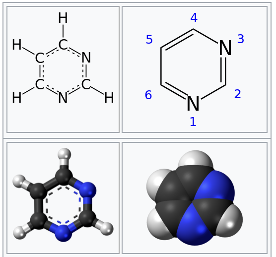
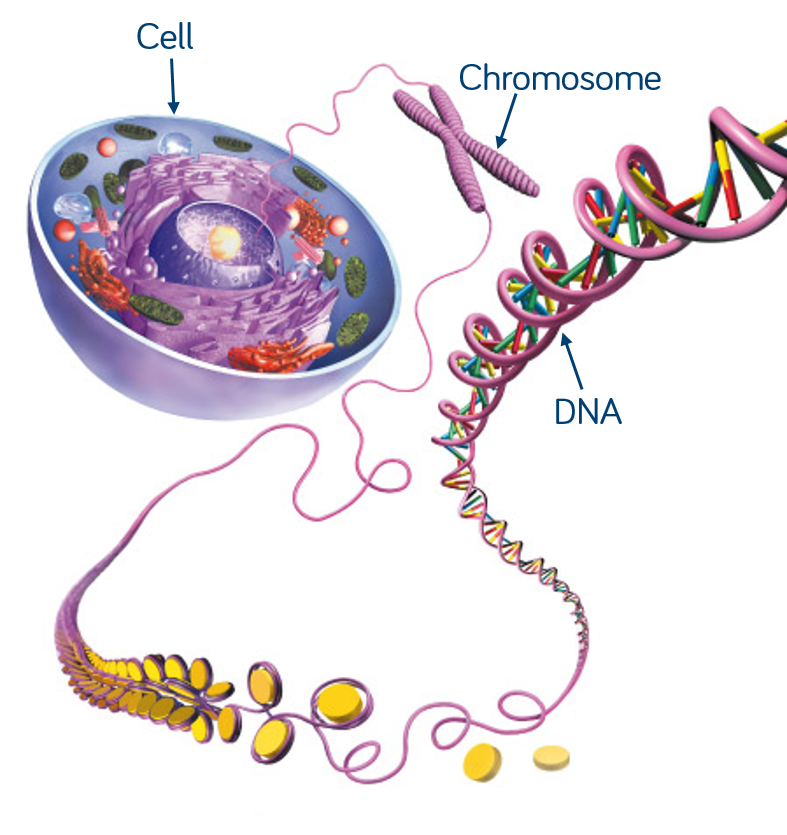
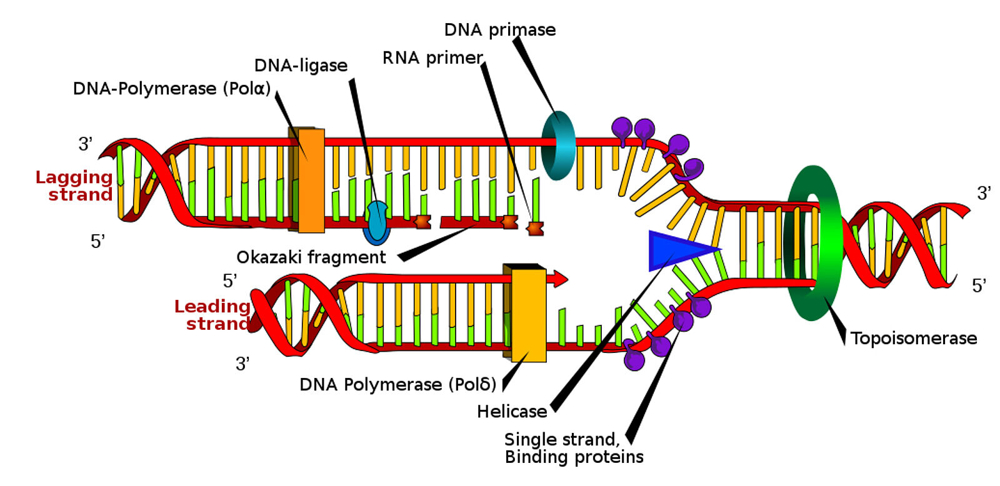

## Warm-up: Review of Session 2 — Live Quiz {.center}

Start of class: scan the QR code on the [session 2 material page](../02-scientific-method/index.qmd) to join the live quiz on the previous lesson.

::: {.notes}
Every lesson starts with an assessment of the previous class. Display the QR code, run the quiz, then discuss the answers before moving on.
:::

## DNA: The Molecule of Life {.center}

- The blueprint of life
- Stored in nearly every cell of your body
- Contains instructions for building and running organisms

::: {.notes}
DNA is one of the most important molecules in nature. It's the instruction manual for life. Every living thing on Earth — from bacteria to humans to plants — uses DNA to store and pass along the information needed to build and maintain life.
:::

## What is DNA?

DNA stands for **deoxyribonucleic acid**.

It is a molecule that:

- Carries genetic instructions for all living things
- Is made up of four chemical bases
- Forms a double helix structure
- Can be copied and passed to offspring

::: {.notes}
The word "deoxyribonucleic" sounds complex, but it just describes the chemical structure. What matters is what DNA does: it stores information. Think of it like a biological computer program or a cookbook with recipes for proteins.
:::

## The Building Blocks: Nucleotides

DNA is made of four types of chemical bases:

:::: {.columns}
::: {.column width="50%"}
**Purines:**
- Adenine (A)
- Guanine (G)
:::
::: {.column width="50%"}
**Pyrimidines:**
- Cytosine (C)
- Thymine (T)
:::
::::

{width="80%" fig-align="center"}

::: {.notes}
These four bases pair up in a specific way: A always pairs with T, and G always pairs with C. This base pairing rule is fundamental to how DNA works — it's how the code is read and copied accurately.
:::

## The Double Helix Structure {background-color="#1d5c9c"}

{width="70%" fig-align="center"}

The discovery of DNA's double helix shape in 1953 by Watson, Crick, Franklin, and Wilkins was one of the greatest scientific breakthroughs.

::: {.notes}
The double helix looks like a twisted ladder. The two sides of the ladder are sugar-phosphate chains, and the rungs are the base pairs. This elegant structure explains how DNA can copy itself perfectly: when the two strands separate, each one can serve as a template to build a new matching strand.
:::

## Understanding Scale: How Small is DNA?

DNA is **incredibly small**.

- 1 meter = **10,000,000,000 angstroms** (10 billion)
- DNA molecules are just a few nanometers wide
- Yet, if all DNA from one cell were unwound and laid end-to-end, it would stretch about **2 meters**

::: {.notes}
This helps students grasp the microscopic scale. We can't see DNA with our eyes or even with a light microscope — we need an electron microscope. Yet there's so much information packed into something so tiny!
:::

## Where is DNA Found?

{width="70%" fig-align="center"}

In humans, most DNA is in the **nucleus** of each cell, but some is also in:
- Mitochondria (powerhouses of the cell)
- Chloroplasts (in plants)

::: {.notes}
The nucleus is like the control center of the cell, and DNA is locked inside it in the form of chromosomes. This isolation helps protect the genetic code from damage.
:::

## DNA Replication: Copying the Code

DNA can make **exact copies** of itself — this is essential for cell division and reproduction.

{width="65%" fig-align="center"}

The process:
1. The double helix unwinds (like unzipping)
2. Each strand serves as a template
3. New bases are added following the pairing rule (A-T, G-C)
4. Two identical copies result

::: {.notes}
Replication is remarkably accurate because of the base pairing rules. An A on the original strand can only pair with a new T, ensuring perfect copying. Occasional errors (mutations) are what drive evolution.
:::

## What is a Gene?

A **gene** is a short segment of DNA that:

- Contains instructions for building one **protein**
- Can be just hundreds to thousands of base pairs long
- Is the basic unit of heredity

{width="60%" fig-align="center"}

::: {.notes}
Genes are like individual recipes in a cookbook. One gene = one protein. That protein might be an enzyme that speeds up a chemical reaction, or a structural protein that gives shape to cells, or an antibody that fights infection. All the proteins in your body are made following instructions in your genes.
:::

## Mutations: Changes to the Code

**Mutations** are changes in the DNA sequence. They can be:

- **Beneficial** — provide an advantage (rare but important for evolution)
- **Neutral** — no noticeable effect
- **Harmful** — can disrupt how proteins work

Effects depend on:
- Where the mutation occurs (in a gene or not)
- How many base pairs are affected
- Which gene is affected

::: {.notes}
Most mutations have very small effects. Evolution works through natural selection of beneficial mutations over millions of years. Harmful mutations are usually weeded out because they reduce survival or reproduction. That's why variation within a species is relatively small — beneficial and harmful mutations balance each other out.
:::

## Key Facts About the Human Genome

| Question | Answer |
|----------|--------|
| How many genes? | ~20,000–25,000 |
| How many base pairs? | ~3 billion |
| What fraction codes for proteins? | Only ~1.5% |
| DNA sequence unique to you? | ~0.1% |

::: {.notes}
These numbers are mind-boggling. The human genome is enormous, but most of it doesn't code for proteins. Much of it is regulatory — it controls when and where genes are turned on and off. A tiny fraction (~0.1%) makes you genetically distinct from everyone else on Earth.
:::

## We Share DNA With All Life

:::: {.columns}
::: {.column width="50%"}
**DNA similarity to humans:**
- Chimpanzees: ~98%
- Mice: ~85%
- Fruit flies: ~50%
- Cabbage: 40–50%
:::
::: {.column width="50%"}
This shows that all life shares a common ancestor. The more distantly related, the less DNA we share.
:::
::::

::: {.notes}
This is powerful evidence for evolution. We share so much DNA with other organisms because we all descended from the same ancestors billions of years ago. The small differences that accumulated over time created the diversity of life we see today.
:::

## The Human Genome Project {background-color="#1d5c9c"}

**Completed: 1990–2003 (13 years, $3 billion)**

Achievements:
- Mapped all ~3 billion base pairs
- Identified ~20,000 genes
- Sequences shared with 20 universities and research centers worldwide

Modern sequencing is now:
- **Faster** (entire genome in hours, not years)
- **Cheaper** ($1,000 instead of $3 billion)
- **More complete** (filling in previously unreadable regions)

::: {.notes}
The Human Genome Project is a triumph of international collaboration and technological advancement. Today, genome sequencing is routine in research and medicine — it's used to understand disease, develop treatments, and trace human ancestry.
:::

## What We Learn From Sequencing

Genome sequencing helps us:

- **Understand disease** — find genetic causes of cancer, diabetes, etc.
- **Develop medicines** — design drugs that target specific proteins
- **Trace evolution** — see how species are related
- **Personalize medicine** — tailor treatments to individual genetics

::: {.notes}
Genomics is transforming medicine. In the future, doctors might sequence a patient's genome to predict disease risk or choose the best treatment based on their individual genetic makeup. This is already starting to happen.
:::

## Recap

- DNA is the molecule that stores genetic instructions for life
- Its double helix structure allows it to replicate accurately
- Genes are short segments of DNA that code for proteins
- The human genome has ~3 billion base pairs and ~20,000 genes
- We share significant DNA with all living organisms
- Genomic technology is revolutionizing medicine and biology
