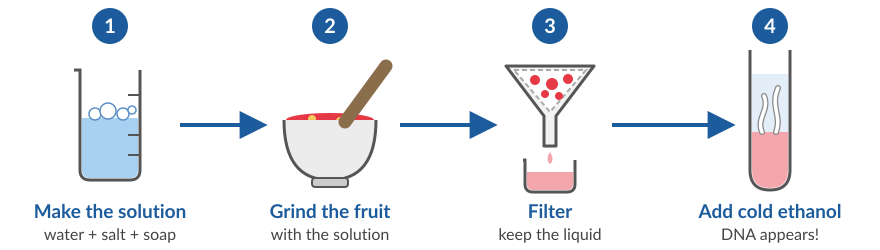
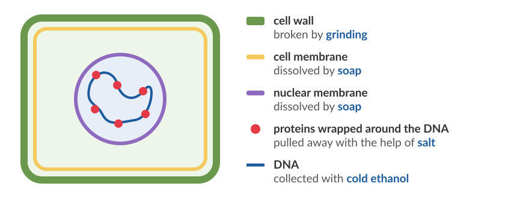
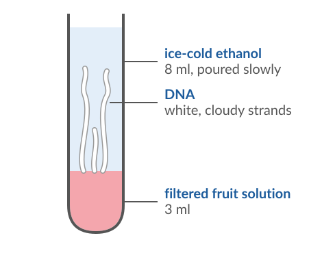
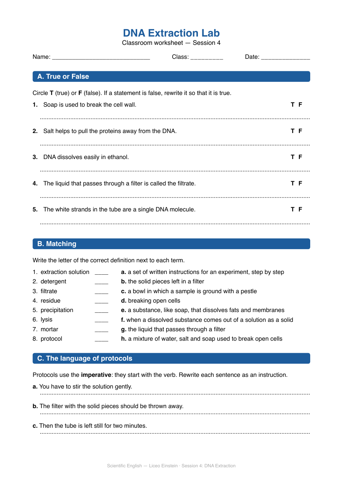

## Warm-up: Review of Session 3 — Live Quiz {.center}

:::: {.columns}
::: {.column width="45%"}

:::
::: {.column width="55%"}
Scan the QR code to join the live quiz on **Understanding DNA** (10 questions).

[Open the quiz](https://forms.gle/5Nn7AqS5zZ5CQjRC6)
:::
::::

::: {.notes}
Every lesson starts with an assessment of the previous class. Display the QR code, run the quiz, then discuss the answers before moving on.
:::

## Session 3 Worksheet: Let's Correct It {.center}

<style>
.reveal .ans { color: #2f6b1f; font-weight: 700; }
.reveal .strand { font-family: monospace; font-size: 1.15em; letter-spacing: 0.15em; }
.reveal .ings { display: flex; gap: 0.6em; align-items: stretch; }
.reveal .ing { flex: 1; text-align: center; background: #eef4fb; border-top: 6px solid #1d5c9c; border-radius: 8px; padding: 0.5em 0.3em 0.6em; }
.reveal .ing .qty { display: block; font-size: 1.5em; font-weight: 700; color: #1d5c9c; }
.reveal .ing .what { display: block; font-size: 0.8em; color: #444; }
.reveal .step-label { color: #1d5c9c; font-weight: 700; }
</style>

:::: {.columns}
::: {.column width="40%"}
{width="100%"}
:::
::: {.column width="60%"}
Take out your worksheet **Exploring DNA** and a pen of a different colour.

1. **True or False** (1–5)
2. **Matching** (1–8)
3. **Complementary strands** (1–4)
4. **The double helix story** (a–f)
:::
::::

::: {.notes}
Correct the session 3 worksheet together. Students mark their own answers with a different colour pen. For each item, ask a student to say their answer and WHY before revealing it (click to reveal). Answer key: material/dna-worksheet-solutions.pdf in session 3.
:::

## Worksheet — True or False {.smaller}

::: {style="font-size: 0.9em;"}
If false, rewrite the statement so that it is true.

| # | Statement | Answer |
|---|---|---|
| 1 | The double helix structure of DNA was discovered in 1869. | [False → **1953** (DNA itself was isolated in 1869)]{.fragment .ans} |
| 2 | A nucleotide is made of a phosphate group, a sugar and a nitrogenous base. | [True]{.fragment .ans} |
| 3 | In DNA, adenine (A) always pairs with guanine (G). | [False → A pairs with **thymine (T)**]{.fragment .ans} |
| 4 | Most mutations are harmful. | [False → most mutations are **neutral**]{.fragment .ans} |
| 5 | Most human cells contain 23 chromosomes. | [False → **46** (23 pairs); only eggs and sperm have 23]{.fragment .ans} |

: {tbl-colwidths="[5,55,40]"}
:::

::: {.notes}
1: Miescher isolated "nuclein" in 1869; Watson and Crick published the double helix in 1953. 3: A–T and G–C; a purine always pairs with a pyrimidine. 4: most mutations fall outside genes or do not change the protein. 5: body cells have two sets (one from each parent); eggs and sperm have one set, so that fertilisation restores 46.
:::

## Worksheet — Matching {.smaller}

::: {style="font-size: 0.92em;"}
| # | Term | Answer |
|---|---|---|
| 1 | nucleotide | [**d** — the building block of DNA: phosphate + sugar + base]{.fragment .ans} |
| 2 | gene | [**f** — a stretch of DNA with the instructions for one product, usually a protein]{.fragment .ans} |
| 3 | genome | [**a** — the complete set of DNA of an organism]{.fragment .ans} |
| 4 | chromosome | [**h** — a tightly packed structure of DNA and proteins; humans have 46]{.fragment .ans} |
| 5 | base pair | [**b** — two bases joined by hydrogen bonds, such as A–T]{.fragment .ans} |
| 6 | mutation | [**g** — a change in the DNA sequence]{.fragment .ans} |
| 7 | replication | [**c** — the process that copies DNA before a cell divides]{.fragment .ans} |
| 8 | histone | [**e** — a protein that DNA is wound around, like thread on a spool]{.fragment .ans} |

: {tbl-colwidths="[6,22,72]"}
:::

::: {.notes}
The usual mix-up is gene vs genome vs chromosome. Use the cookbook analogy from session 3: genome = the whole cookbook, chromosome = a chapter, gene = a recipe.
:::

## Worksheet — Complementary Strands {.smaller}

:::: {.columns}
::: {.column width="50%"}
**1.** [TTAGCCATGC]{.strand}<br>
[→ [AATCGGTACG]{.strand}]{.fragment .ans}

**2.** [CGAATTCGTA]{.strand}<br>
[→ [GCTTAAGCAT]{.strand}]{.fragment .ans}
:::
::: {.column width="50%"}
**3.** A DNA sample contains **30 % A**. What about T, G and C?

[T = 30 %, G = 20 %, C = 20 %]{.fragment .ans}

**4.** Which DNA is harder to separate: rich in A–T or rich in G–C?

[G–C: each G–C pair has **3** hydrogen bonds, A–T only **2**]{.fragment .ans}
:::
::::

::: {.notes}
3: A = T, so A + T = 60 %. The remaining 40 % is split equally between G and C. This is Chargaff's rule, which we met in the double helix case study. 4: more hydrogen bonds = more energy needed to separate the strands (DNA rich in G–C "melts" at a higher temperature).
:::

## Worksheet — The Double Helix Story {.smaller}

::: {style="font-size: 0.92em;"}
| | Event | Step of the scientific method |
|---|---|---|
| a | Chargaff notices that A ≈ T and G ≈ C in every species | [observation]{.fragment .ans} |
| b | Franklin and Gosling take X-ray photographs of DNA (Photo 51) | [data collection]{.fragment .ans} |
| c | Watson and Crick propose a model of the structure of DNA | [hypothesis]{.fragment .ans} |
| d | Their first model is wrong, so they build a new one | [revising the hypothesis]{.fragment .ans} |
| e | The double helix model is published in *Nature* in 1953 | [communicating the conclusion]{.fragment .ans} |
| f | In 1958 Meselson and Stahl check whether each new DNA molecule keeps one old strand | [testing a prediction]{.fragment .ans} |

: {tbl-colwidths="[4,62,34]"}
:::

::: {.notes}
This links sessions 2 and 3: real science follows the cycle of the scientific method, including going back when a hypothesis turns out to be wrong (d).
:::

# Today: See DNA with Your Own Eyes {background-color="#1d5c9c"}

::: {.notes}
Hook: last week we said the double helix is only 2 nm wide, far too small for any light microscope. Today, in the lab, you will extract DNA from fruit and see it with your own eyes. You will not see one molecule: you will see millions of molecules clumped together.
:::

## The Plan

{width="100%" fig-align="center" fig-alt="Four steps: 1, make the extraction solution of water, salt and soap; 2, grind the fruit with the solution; 3, filter and keep the liquid; 4, add cold ethanol and DNA appears"}

Four steps, about **30 minutes**, using things you can find in a kitchen.

::: {.notes}
Give the big picture before any detail, so students know where each step is going. Then for each step we will ask two questions: WHAT do we do, and WHY.
:::

## Where Is the DNA?

{width="95%" fig-align="center" fig-alt="A plant cell: the cell wall is broken by grinding; the cell membrane and the nuclear membrane are dissolved by soap; the proteins wrapped around the DNA are pulled away with the help of salt; the DNA is collected with cold ethanol"}

::: {.notes}
Recall session 3: DNA is mostly in the nucleus, wound around histone proteins. To get it out of a plant cell we have to get through three barriers (cell wall, cell membrane, nuclear membrane) and then separate the DNA from its proteins. Each ingredient of today's protocol has one job. Ask: animal cells have no cell wall; which step would be easier with animal cells?
:::

## Make a Prediction {.smaller}

::: {.callout-note}
**Question:** Which fruit gives **more** DNA from the same mass: **banana** or **strawberry**?
:::

Write your hypothesis: *"If we use …, then …, because …"*

::: {.fragment}
**Keep it fair:** what do we change, what do we measure, what do we keep the same?

| Independent variable | Dependent variable | Controlled variables |
|---|---|---|
| type of fruit | amount of DNA we see | mass of fruit, volume of solution, volume of ethanol, time |
:::

::: {.notes}
Link to session 2: a fair test changes only one variable. Let students vote before the lab. The answer comes at the end: strawberries usually give much more DNA. Strawberries are octoploid, they have 8 copies of each chromosome (bananas have 3), and they are soft and easy to break.
:::

## Lab Safety

:::: {.columns}
::: {.column width="50%"}
::: {.callout-warning}
- Wear **goggles**
- Ethanol is **flammable**: no flames nearby
- **Do not eat** or drink anything in the lab
:::
:::
::: {.column width="50%"}
::: {.callout-tip}
- Label your tubes: **B** (banana), **S** (strawberry)
- Work in **pairs**: one person reads, one person does
- **Wash your hands** at the end
:::
:::
::::

::: {.notes}
Keep the ethanol in the freezer or on ice until step 4. Check that every pair has goggles before handing out the ethanol.
:::

## Step 1: The Extraction Solution

:::: {.ings}
::: {.ing}
[50 ml]{.qty}
[water]{.what}
:::
::: {.ing}
[2 tsp]{.qty}
[2 teaspoons of cooking salt (NaCl)]{.what}
:::
::: {.ing}
[1 tbsp]{.qty}
[1 tablespoon of washing-up liquid (soap)]{.what}
:::
::::

<br>

Stir **gently** until the salt dissolves. Avoid making foam.

::: {.notes}
Washing-up liquid is the soap for washing dishes by hand (in American English: dish soap). Not dishwasher tablets! Foam makes it hard to measure and to see the DNA later.
:::

## Why These Ingredients?

| Ingredient | Its job |
|---|---|
| **Soap** | dissolves the **membranes** (made of fats called phospholipids), so the cell and the nucleus break open |
| **Salt** | pulls the **proteins** away from the DNA and neutralises the DNA's negative charges, so the strands can **clump together** |
| **Water** | the **solvent**: everything else dissolves in it |

: {tbl-colwidths="[18,82]"}

::: {.notes}
Soap works on cell membranes the same way it works on greasy plates: membranes are made of phospholipids, which are fats. Salt: DNA's phosphate groups are negatively charged (the "acid" in deoxyribonucleic acid, session 3), so DNA strands push each other away. The positive sodium ions (Na+) cover these negative charges, so the strands can come together and later precipitate.
:::

## Step 2: Prepare the Sample

:::: {.columns}
::: {.column width="55%"}
1. **Weigh** about ⅓ of a banana
2. **Weigh** the same mass of strawberries
3. **Grind** each fruit in its own mortar
4. **Add** the extraction solution and **mix** gently
:::
::: {.column width="45%"}
::: {.callout-tip}
**Why gently?** DNA molecules are very long and thin. Strong shaking breaks them into short pieces, which are harder to see.
:::
:::
::::

::: {.notes}
Grinding breaks the cell walls (step 1 of the barriers). Same mass = controlled variable (fair test). Two separate mortars so that the samples do not mix. Let the mixture rest for a few minutes so the soap and salt can work.
:::

## Step 3: Filter

:::: {.columns}
::: {.column width="55%"}
1. **Filter** each mixture through a coffee filter
2. **Collect** the liquid that passes through: the **filtrate**
3. **Throw away** the filter with the solid pieces
:::
::: {.column width="45%"}
::: {.callout-note}
**Vocabulary:** *filtrate* — the liquid that passes through a filter. The solids left in the filter are the *residue*.
:::
:::
::::

::: {.notes}
The DNA is now dissolved in the liquid, so we keep the liquid and discard the solids (pieces of cell wall, seeds, fibres). Filtering takes a few minutes: do not squeeze the filter, or debris gets into the filtrate.
:::

## Step 4: Make the DNA Appear

:::: {.columns}
::: {.column width="45%"}
{width="100%" fig-alt="A test tube: 3 ml of filtered fruit solution at the bottom, 8 ml of ice-cold ethanol on top, and white cloudy DNA strands rising from the boundary"}
:::
::: {.column width="55%"}
1. **Transfer** about 3 ml of filtrate into a clean tube
2. Slowly **pour** 8 ml of **ice-cold ethanol** down the side of the tube
3. **Wait**: do not shake!
4. **Observe**: white, cloudy strands appear where the two liquids meet
:::
::::

::: {.notes}
Tilt the tube and let the ethanol run down the side, so it floats on top as a separate layer (ethanol is less dense than water). After a minute or two the DNA appears at the boundary and rises into the ethanol. Students can wind it around a wooden stick or a paper clip.
:::

## Why Does the DNA Appear?

- DNA **dissolves in water**, but **not in ethanol**
- Ethanol pulls the water away from the DNA, so the DNA molecules **clump together** and come out of the solution
- This is called **precipitation**; cold ethanol works better
- Salt helps: with its charges neutralised, DNA clumps more easily

::: {.callout-note}
What you see is **millions of DNA molecules** stuck together, not a single double helix: one helix is only 2 nm wide!
:::

::: {.notes}
Precipitation = a dissolved substance comes out of a solution as a solid. Link to session 3 (how small is DNA?): a single molecule is far too thin to see; you are seeing a huge bundle. The white strands also contain some RNA and proteins, so our DNA is not pure. A real lab needs purer DNA: last slide.
:::

## DNA Extraction: Full Protocol {#full-protocol .smaller}

```{=html}
<style>
.reveal .proto { display: grid; grid-template-columns: 1fr 1fr; gap: 10px; text-align: left; }
.reveal .proto .card { background: #eef4fb; border-top: 6px solid #1d5c9c; border-radius: 8px; padding: 4px 16px 6px; font-size: 25px; line-height: 1.22; }
.reveal .proto .title { font-weight: 700; color: #1d5c9c; font-size: 27px; margin-bottom: 2px; }
.reveal .proto ol { margin: 0 0 0 1em; display: block; }
.reveal .proto li { margin: 0; }
.reveal .proto-safety { margin-top: 10px; background: #fdf3d8; border-radius: 8px; padding: 3px 14px; font-size: 22px; text-align: center; }
</style>
<div class="proto">
<div class="card">
<div class="title">1 · Make the extraction solution</div>
<ol>
<li><b>Mix</b> <b>50 ml</b> of water, <b>2 tsp</b> of salt and <b>1 tbsp</b> of washing-up liquid</li>
<li><b>Stir</b> gently until the salt dissolves (no foam!)</li>
</ol>
</div>
<div class="card">
<div class="title">2 · Prepare the sample</div>
<ol>
<li><b>Weigh</b> about <b>⅓ of a banana</b></li>
<li><b>Weigh</b> the same mass of strawberries</li>
<li><b>Grind</b> each fruit in its own mortar</li>
<li><b>Add</b> the extraction solution and <b>mix</b> gently</li>
</ol>
</div>
<div class="card">
<div class="title">3 · Filter</div>
<ol>
<li><b>Filter</b> each mixture through a coffee filter</li>
<li><b>Collect</b> the liquid: the <i>filtrate</i></li>
<li><b>Throw away</b> the filter with the solid pieces</li>
</ol>
</div>
<div class="card">
<div class="title">4 · Make the DNA appear</div>
<ol>
<li><b>Transfer</b> about <b>3 ml</b> of filtrate into a clean tube</li>
<li><b>Pour</b> <b>8 ml</b> of <b>ice-cold ethanol</b> slowly down the side</li>
<li><b>Wait</b> two minutes: do not shake!</li>
<li><b>Observe</b> the white, cloudy strands</li>
</ol>
</div>
</div>
<div class="proto-safety">⚠️ <b>Goggles on</b> · Ethanol is <b>flammable</b>: no flames · <b>Do not eat</b> or drink · Label tubes <b>B</b> and <b>S</b></div>
```

::: {.notes}
Leave this slide on screen during the practical. It summarises steps 1–4 and the safety rules.
:::

## The Language of Protocols {.smaller}

:::: {.columns}
::: {.column width="50%"}
Protocols use the **imperative**: start with the verb.

- *Weigh* the fruit.
- *Grind* the sample.
- *Transfer* 3 ml into a tube.
- *Discard* the filter.
:::
::: {.column width="50%"}
**Rewrite as instructions:**

1. You should take 50 ml of water.
2. The ethanol is poured slowly.
3. Then you have to wait two minutes.

::: {.fragment .ans}
→ *Take* 50 ml of water.<br>
→ *Pour* the ethanol slowly.<br>
→ *Wait* two minutes.
:::
:::
::::

::: {.notes}
Protocols (and recipes) are short, clear instructions in order. Useful verbs: weigh, measure, grind, mix, stir, add, pour, filter, transfer, discard, observe, record. Units: ml (millilitre), g (gram), tsp (teaspoon), tbsp (tablespoon). Students can do this while the filtration is running.
:::

## Record Your Results

| Fruit | Mass (g) | What do you see? (amount, colour, texture) |
|---|---|---|
| Banana | | |
| Strawberry | | |

: {tbl-colwidths="[22,18,60]"}

::: {.fragment}
**Conclusion:** Was your hypothesis supported? Which fruit gave more DNA, and **why**?
:::

::: {.notes}
Usually strawberries give much more DNA. Why: strawberries are octoploid (8 copies of each chromosome), bananas are triploid (3 copies); strawberries are also very soft and easy to break. A good discussion: is "amount we see" a precise measurement? (No: it is a qualitative observation. How could we measure it better? Weigh the DNA, or measure it with a spectrophotometer.)
:::

## From the Kitchen to the Real Lab {.smaller}

| Our protocol | A real lab kit |
|---|---|
| Grind in a mortar | Grind frozen tissue, or shake with tiny beads |
| Soap + salt | **Lysis buffer** (detergent + salts) and enzymes that digest proteins |
| Coffee filter | A **centrifuge** spins the debris to the bottom |
| Cold ethanol | DNA sticks to a **silica membrane**, is washed with ethanol, then released in water |
| Cloudy white strands | **Pure DNA**, ready for analysis (e.g. sequencing) |

: {tbl-colwidths="[35,65]"}

[An example of a real protocol (QIAGEN) →](https://www.qiagen.com/us/resources/resourcedetail?id=f6455f80-dc4f-4ff2-b2de-ae7a3e6c91e0&lang=en)

::: {.notes}
The idea is the same: break the cells, remove the proteins and debris, collect the DNA. Lab kits are faster, more reproducible, and give much purer DNA, which is needed for techniques like PCR and sequencing (Biotech and Bioinformatics sessions). Lysis = breaking open cells (from Greek "loosening").
:::

## Recap {.smaller}

- To extract DNA we break the **cell wall** (grinding) and the **membranes** (soap)
- **Salt** pulls proteins away from DNA and helps it clump
- **Filtering** removes the solid debris
- **Cold ethanol** makes the DNA **precipitate**: we see millions of molecules together
- A fair test changes **one variable** (the fruit) and keeps the others the same
- Protocols are written in the **imperative**: *weigh, grind, filter, pour*

## Classroom Exercise: DNA Extraction Lab {.smaller}

:::: {.columns}
::: {.column width="40%"}
{width="100%" fig-align="center"}
:::
::: {.column width="60%"}
Worksheet handed out on paper in class. It covers:

- **True or False**: correct 5 statements about the extraction
- **Matching**: match 8 lab terms (filtrate, residue, precipitation, lysis…) to their definitions
- **The language of protocols**: rewrite sentences in the imperative
- **The order of the protocol**: put the 8 steps in the right order
- **Your experiment**: hypothesis, variables, results and conclusion for banana vs strawberry
:::
::::

::: {.notes}
Hand out the paper worksheet (material/dna-extraction-worksheet.pdf). Parts A–D can be done while the mixtures are filtering; part E is filled in during and after the experiment. Answer key: material/dna-extraction-worksheet-solutions.pdf. Part A: 1 False, soap dissolves the membranes, grinding breaks the cell wall; 2 True; 3 False, DNA dissolves in water but not in ethanol; 4 True; 5 False, millions of molecules clumped together. Part B: 1-h, 2-e, 3-g, 4-b, 5-f, 6-d, 7-c, 8-a. Part C: (a) Stir the solution gently; (b) Throw away the filter with the solid pieces; (c) Leave the tube still for two minutes / Wait two minutes. Part D, in the order printed: 5, 2, 7, 1, 8, 3, 6, 4. Part E: independent variable = type of fruit; dependent = amount of DNA seen; controlled = mass of fruit, volumes, ethanol temperature, waiting time.
:::
