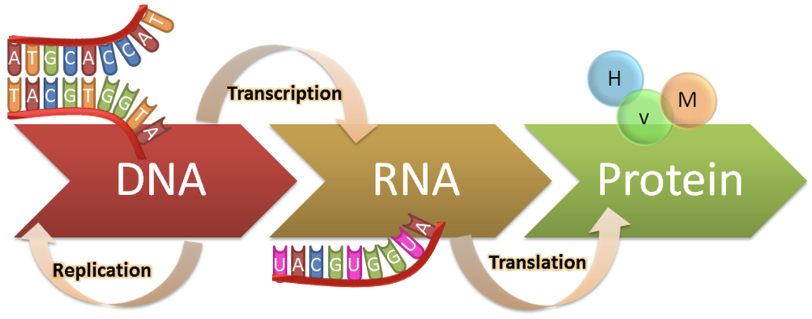
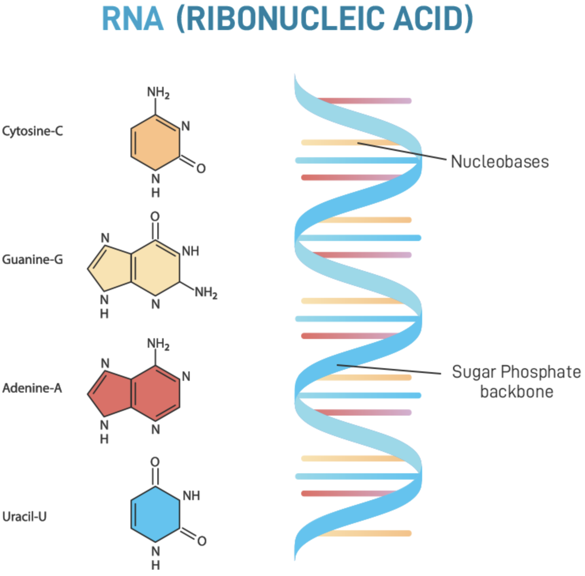
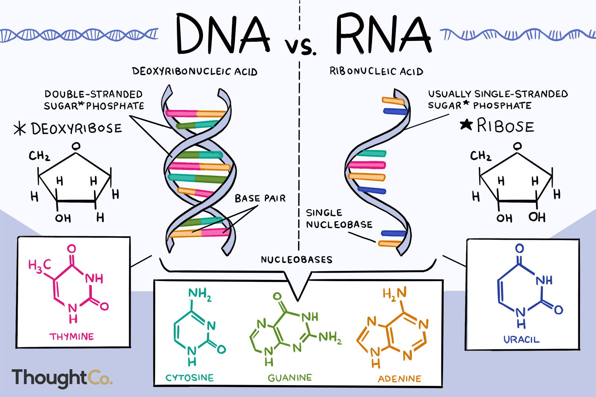
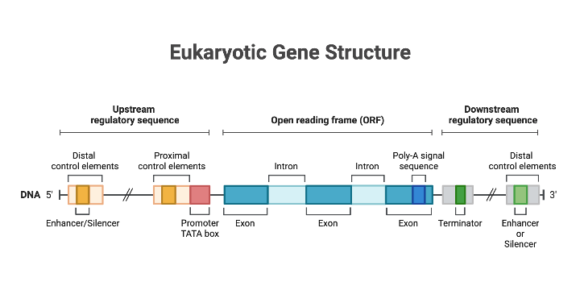
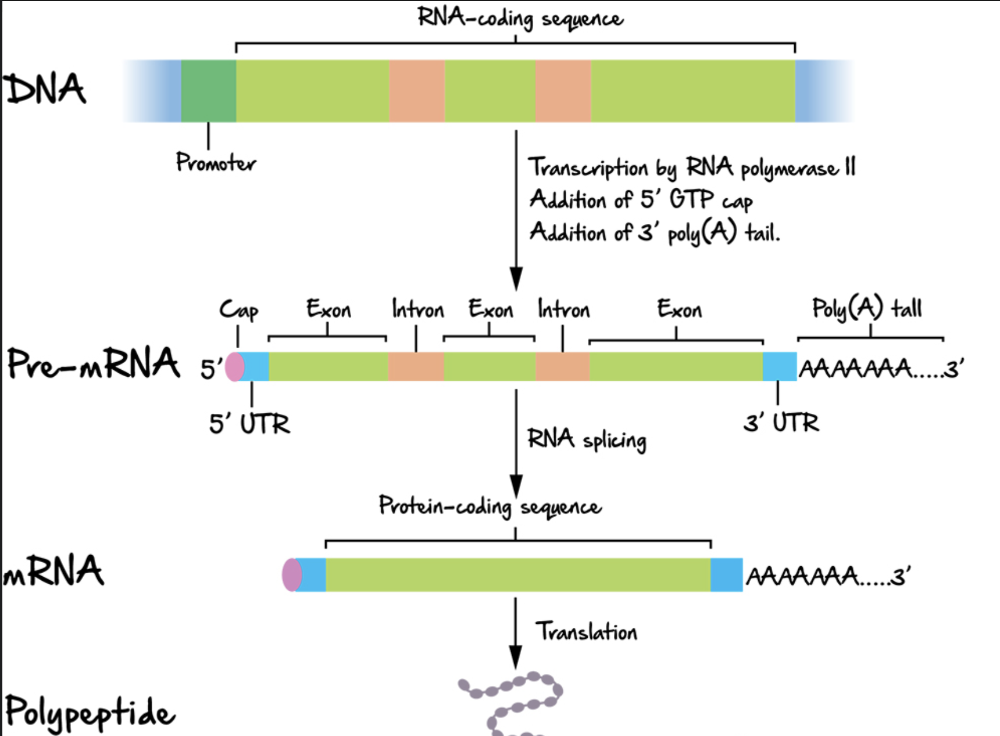

## Warm-up: Review of Session 4 — Live Quiz {.center}

Start of class: scan the QR code on the [session 4 material page](../04-dna-extraction/index.qmd) to join the live quiz on the previous lesson.

::: {.notes}
Every lesson starts with an assessment of the previous class. Display the QR code, run the quiz, then discuss the answers before moving on.
:::

## Central Dogma {.center}

Understand how genetic information flows from DNA through RNA to create proteins

::: {.notes}
Welcome to the session on Central Dogma. This is an important topic in biology and science. Throughout this session, we'll explore key concepts, look at real-world examples, and think about why this matters.
:::

## Slide 2

{width="70%" fig-align="center"}

## Slide 3

- TRANSCRIPTION

## Slide 4

- Transcription is the process by which information encoded in DNA 
is converted into RNA
- TRANSCRIPTION
- It plays a crucial role in 
gene expression and protein synthesis.

## Slide 5

- It is a type of nucleic acid
It plays a crucial role in various cellular processes
Particularly in the flow of genetic information within a cell

{width="70%" fig-align="center"}

## Slide 6

{width="70%" fig-align="center"}

## Slide 7

## Slide 8

- Key Players in Transcription
- DNA: Double-stranded helix containing genetic instructions
RNA Polymerase: Enzyme responsible for synthesizing RNA from DNA template

## Slide 9

## Slide 10

## Slide 11

- TRANSCRIPTION
- The starting point for transcription is determined by a region on the DNA called the "promoter." The promoter is a specific sequence of nucleotides that signals the RNA polymerase where to begin transcription.

{width="70%" fig-align="center"}

## Slide 12

- TRANSCRIPTION
- Here are the key steps in transcription initiation:
Recognition of the Promoter: The RNA polymerase, along with other regulatory proteins called transcription factors, recognizes and binds to the promoter region on the DNA.

{width="70%" fig-align="center"}

## Slide 13

- TRANSCRIPTION
- The promoter sequence typically includes specific nucleotide sequences, such as the TATA box in eukaryotes, which helps in positioning the RNA polymerase.

{width="70%" fig-align="center"}

## Slide 14

- TRANSCRIPTION
- Here are the key steps in transcription initiation:
Formation of Transcription Initiation Complex: The binding of RNA polymerase and transcription factors at the promoter forms the transcription initiation complex. This complex marks the starting point for RNA synthesis.

{width="70%" fig-align="center"}

## Slide 15

- TRANSCRIPTION
- Here are the key steps in transcription initiation:
Unwinding of DNA: The transcription initiation complex helps in unwinding the DNA double helix at the promoter site, exposing a small stretch of DNA for RNA synthesis.

{width="70%" fig-align="center"}

## Slide 16

- TRANSCRIPTION
- Here are the key steps in transcription initiation:
Start of RNA Synthesis: Once the DNA is unwound, the RNA polymerase begins synthesizing RNA in the 5' to 3' direction, using one of the DNA strands as a template. The RNA polymerase adds complementary RNA nucleotides to the growing RNA chain.

{width="70%" fig-align="center"}

## Slide 17

{width="70%" fig-align="center"}

## Slide 18

- TRANSLATION

## Slide 19

- Translation refers to the process by which information encoded in messenger RNA (mRNA) is used to synthesize a corresponding protein.
- TRANSLATION

## Slide 20

- TRANSLATION
- Initiation: The process begins with the binding of the small ribosomal subunit to the mRNA. The initiator tRNA, carrying the amino acid methionine, attaches to the start codon (AUG) on the mRNA. The large ribosomal subunit then joins, forming a functional ribosome.

## Slide 21

- TRANSLATION
- Elongation: During elongation, the ribosome moves along the mRNA, reading the codons in groups of three (codons are the three-nucleotide sequences on the mRNA that code for specific amino acids). As each codon is read, a corresponding tRNA molecule carries the appropriate amino acid to the ribosome. The amino acids are then joined together to form a growing polypeptide chain.
- Translation occurs in the ribosomes, which are cellular structures composed of ribosomal RNA (rRNA) and proteins

## Slide 22

- TRANSLATION
- Termination: The process continues until a stop codon (UAA, UAG, or UGA) is encountered on the mRNA. When a stop codon is reached, a release factor binds to the ribosome, causing the newly synthesized protein to be released. The ribosomal subunits then dissociate from the mRNA.

## Slide 23

## Slide 24

- ACTIVITY

## Slide 25

## Slide 26

## Slide 27

- SPLICING

## Recap

- Key concepts reviewed
- Real-world applications explored
- Ready for assessment
