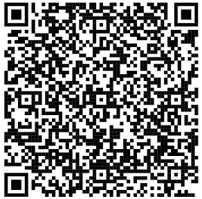
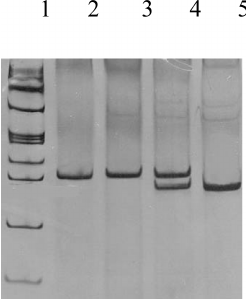
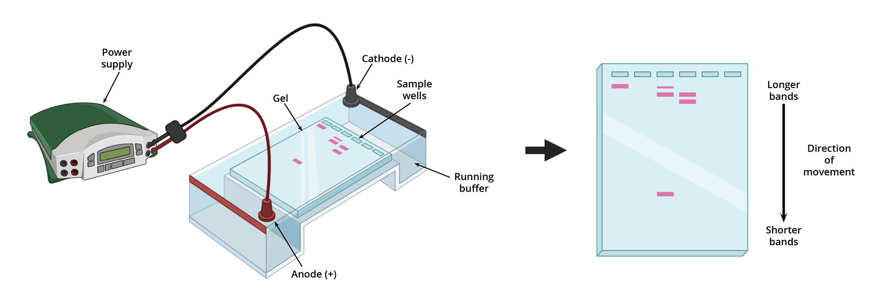
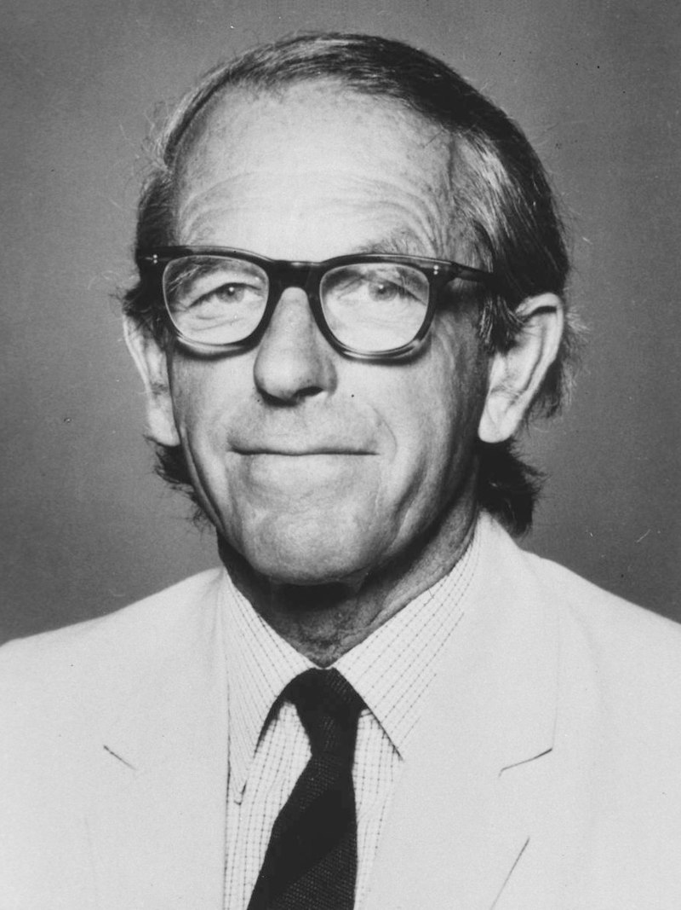
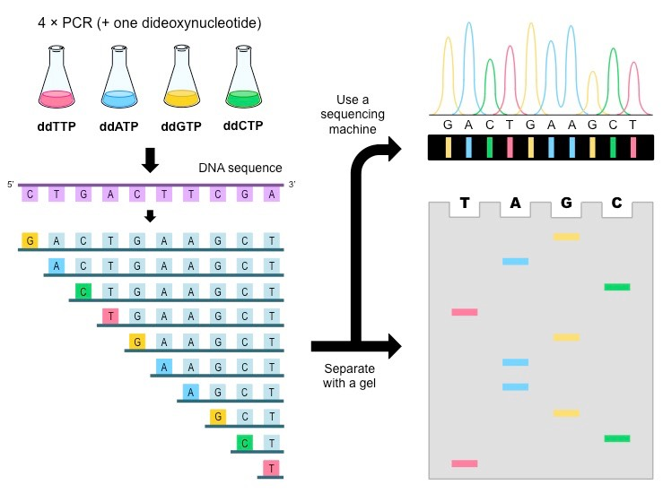
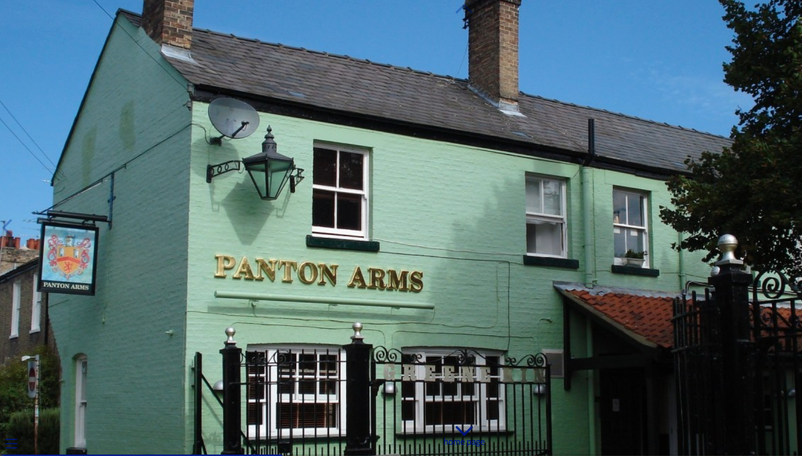
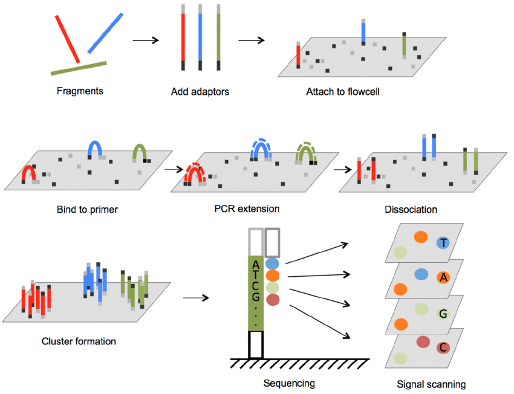

## Biotech I {.center}

Explore how biotechnology tools use DNA to solve real-world problems

::: {.notes}
Welcome to the session on Biotech I. This is an important topic in biology and science. Throughout this session, we'll explore key concepts, look at real-world examples, and think about why this matters.
:::

## Slide 2

{width="70%" fig-align="center"}

## Slide 3

- Understanding DNA is of paramount importance for several reasons:
- Basis of Life: DNA is the fundamental building block of life
Genetic Information: DNA encodes the genetic information that determines an organism's traits.
Medical Advances: Knowledge of DNA has led to breakthroughs in medicine
Evolutionary Studies: DNA provides crucial evidence for understanding evolutionary relationships among species.

## Slide 4

- Understanding DNA is of paramount importance for several reasons:
- Forensic Science: DNA profiling is a powerful tool in forensic investigations
Biotechnology and Agriculture: DNA technologies are extensively used in biotechnology for genetic engineering
Drug Development: Understanding DNA is crucial in drug discovery and development.

## Slide 5

- Understanding DNA is of paramount importance for several reasons:
- Environmental Studies: DNA analysis is employed in environmental studies to assess biodiversity, identify species, and monitor ecosystems
Disease Research: Many diseases have a genetic component

## Slide 6

- Polymerase Chain Reaction (PCR)
DNA Sequencing
- Overview

## Slide 7

- Polymerase Chain Reaction (PCR)

## Slide 8

- Kary Mullis
- Mullis practiced clandestine chemistry throughout his graduate studies, specializing in the synthesis of LSD
Mullis publicly recounted his belief in various paranormal activities and his direct participation in some of them

## Slide 9

## Slide 10

## Slide 11

- Gel Electrophoresis 
DNA's Race Track

## Slide 12

- Gel Electrophoresis
- Gel electrophoresis is a technique used to separate DNA fragments by size.
It's like a race where DNA fragments run through a gel, with the smallest fragments moving the fastest.
This allows us to "see" the different sizes of DNA and compare them.

{width="70%" fig-align="center"}

## Slide 13

- How Does it Work?
- DNA samples are loaded into wells (small holes) in a gel.
An electric current is applied, and the negatively charged DNA moves towards the positive electrode.

{width="70%" fig-align="center"}

## Slide 14

- How Does it Work?
- Smaller DNA fragments move faster and farther through the gel, while larger fragments move slower.
This creates a pattern of bands, with each band representing a different size of DNA.

{width="70%" fig-align="center"}

## Slide 15

- The Gel: A Molecular Sieve
- The gel is made of a special substance called agarose.   
Agarose is a natural polymer derived from seaweed.   
It forms a porous matrix, like a sponge, with tiny holes and channels.   
These pores allow DNA fragments to move through the gel, but the smaller fragments navigate the maze faster!

## Slide 16

- PCR Exercises

## Slide 17

- DNA Sequencing

## Slide 18

- Nobel Prize for determining the base sequence of nucleic acids awarded to Frederick Sanger
- Frederick Sanger
- Frederick Sanger won the Nobel Prize in chemistry twice, the first time in 1958 and again in 1980

{width="70%" fig-align="center"}

## Slide 19

{width="70%" fig-align="center"}

## Slide 20

{width="70%" fig-align="center"}

## Slide 21

- Shankar Balasubramanian and David Klenerman
- Sequencing by synthesis

{width="70%" fig-align="center"}

## Slide 22

{width="70%" fig-align="center"}

## Slide 23

## Slide 24

- Challenge 1
- AGCTCG
- Key: Red = A, Yellow = G, Green = C, Blue = T

## Slide 25

- Challenge 1
- TCAGAG
- Key: Red = A, Yellow = G, Green = C, Blue = T

## Slide 26

- Challenge 2
- TAGCTAGC
- Key: Blue = T, Yellow = A, Green = G, Red = C

## Slide 27

- Challenge 2
- GCTAGCTA
- Key: Blue = T, Yellow = A, Green = G, Red = C

## Slide 28

- Challenge 3
- CATGACTGCA
- Key: Green = C, Yellow = A, Red = T, Blue = G

## Slide 29

- Challenge 3
- GTACAGTCAT
- Key: Green = C, Yellow = A, Red = T, Blue = G

## Slide 30

- Challenge 4
- AGCTCGCATTGC
- Key: Red = A, Blue = G, Yellow = C, Green = T

## Slide 31

- Challenge 4
- TCGAGCGTAACG
- Key: Red = A, Blue = G, Yellow = C, Green = T

## Slide 32

- CRISPR-Cas9

## Slide 33

- Emmanuelle Charpentier and Jennifer Doudna

## Slide 34

## Slide 35

## Slide 36

- The vital data you flush down the toilet

## Recap

- Key concepts reviewed
- Real-world applications explored
- Ready for assessment

## Quick Check — Live Quiz {.center}

Scan the QR code on the [session material page](index.qmd) (or ask your teacher to display it) to join the live quiz on this session.
