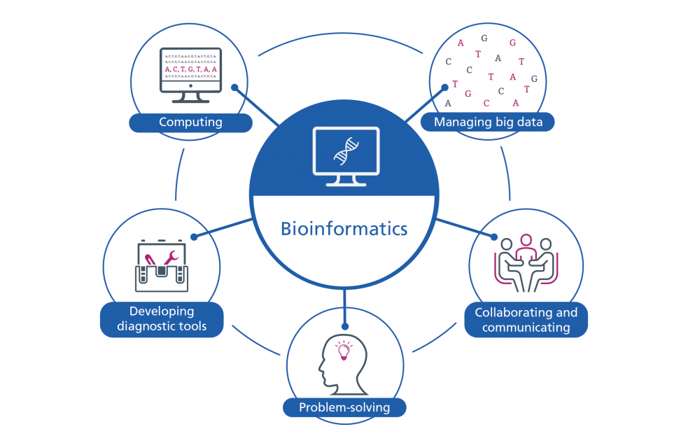
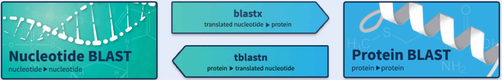

## Warm-up: Review of Session 6 — Live Quiz {.center}

Start of class: scan the QR code on the [session 6 material page](../06-biotech-I/index.qmd) to join the live quiz on the previous lesson.

::: {.notes}
Every lesson starts with an assessment of the previous class. Display the QR code, run the quiz, then discuss the answers before moving on.
:::

## Bioinformatics {.center}

Learn how computers and algorithms analyze DNA sequences and large datasets

::: {.notes}
Welcome to the session on Bioinformatics. This is an important topic in biology and science. Throughout this session, we'll explore key concepts, look at real-world examples, and think about why this matters.
:::

## Slide 2

- What is Bioinformatics?
- Bioinformatics is the interdisciplinary field that uses computational techniques to analyze biological data.
It involves the application of mathematics, statistics, and computer science to understand and interpret biological information.

{width="70%" fig-align="center"}

## Slide 3

- Why is Bioinformatics Important?
- Understanding Biological Systems: Bioinformatics helps scientists understand complex biological systems by analyzing and interpreting large volumes of biological data.

## Slide 4

- Why is Bioinformatics Important?
- Drug Discovery and Development: By analyzing biological data, bioinformatics contributes to the discovery and development of new drugs and therapie

## Slide 5

- Why is Bioinformatics Important?
- Personalized Medicine: Bioinformatics plays a key role in personalized medicine by analyzing individual genetic variations and identifying personalized treatment options

## Slide 6

- Why is Bioinformatics Important?
- Conservation Biology: Bioinformatics contributes to conservation biology by analyzing genetic data to understand biodiversity

## Slide 7

- Why is Bioinformatics Important?
- Biotechnology and Industry: leading to the discovery of new biomolecules, enzymes, and therapeutic agents

## Slide 8

- Skills Required
- Strong foundation in biology 
Strong foundation in computer science
Proficiency in programming languages like Python and R
Data analysis and critical thinking skills
Ability to work with large datasets and bioinformatics software tools.

## Slide 9

## Slide 10

- FASTA format
- FASTA is a commonly used file format for representing nucleotide or protein sequences. 
It is a simple and widely recognized format that consists of two main parts: header and sequence
- >Sequence_1
ATCGATCGATCGATCGATCGATCGATCGATCG

## Slide 11

- FASTA format
- FASTA is a commonly used file format for representing nucleotide or protein sequences. 
It is a simple and widely recognized format that consists of two main parts: header and sequence
- >Sequence_2
MVLRKVGKYEIGRTIGEGTFAKVKFAQNTETGE

## Slide 12

- UniProt
- https://www.uniprot.org/

## Slide 13

- Basic Local Alignment Search Tool (BLAST)
- BLAST finds regions of similarity between biological sequences. The program compares nucleotide or protein sequences to sequence databases and calculates the statistical significance.

{width="70%" fig-align="center"}

## Slide 14

- https://tinyurl.com/3bdzzepw
- Unknown sequences

## Slide 15

- https://tinyurl.com/2m8fcv49
- Plant sequences

## Slide 16

- https://tinyurl.com/ynenh67v
- Gel

## Slide 17

{width="70%" fig-align="center"}

## Recap

- Key concepts reviewed
- Real-world applications explored
- Ready for assessment
