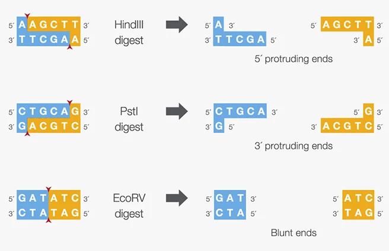
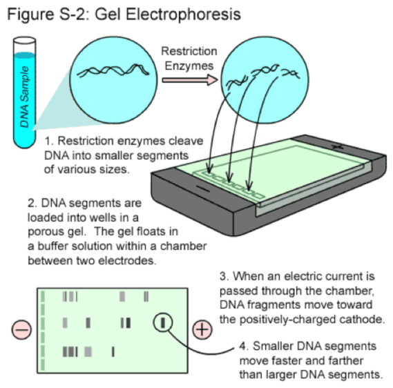
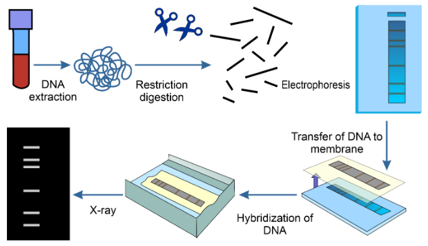

## Forensic DNA {.center}

Discover how DNA evidence is used to solve crimes and identify individuals

::: {.notes}
Welcome to the session on Forensic DNA. This is an important topic in biology and science. Throughout this session, we'll explore key concepts, look at real-world examples, and think about why this matters.
:::

## Slide 2

- https://shorturl.at/4pNXc

## Slide 3

- Introduction to Forensic DNA
- Forensic DNA analysis (DNA profiling or DNA fingerprinting) is a scientific method used in criminal investigations to identify individuals or determine their relationship to a crime scene

## Slide 4

- Introduction to Forensic DNA
- From biological evidence (such as blood, saliva, hair, or skin cells) found at crime scenes:
extraction
analysis
comparison of DNA samples obtained

## Slide 5

- Introduction to Forensic DNA
- By comparing the DNA profile obtained from evidence with the DNA profiles of known individuals (suspects or victims), forensic scientists can establish links between individuals and crime scenes, identify suspects, exonerate the innocent, and provide crucial evidence in criminal trials.

## Slide 6

- DNA Profiling
- DNA fingerprinting
STR analysis (Short Tandem Repeat)

## Slide 7

- DNA Profiling
- DNA fingerprinting
It is a forensic technique used to identify individuals based on their unique genetic makeup
 It plays a crucial role in criminal investigations, paternity testing, and identifying victims in mass disasters
DNA fingerprinting compares specific regions of an individual's DNA to generate a unique genetic profile

## Slide 8

- DNA Profiling

{width="70%" fig-align="center"}

## Slide 9

- DNA Profiling

{width="70%" fig-align="center"}

## Slide 10

- DNA Profiling

{width="70%" fig-align="center"}

## Slide 11

- DNA Profiling
- Restriction Fragment Length Polymorphism (RFLP) DNA fingerprinting
VNTR (Variable Number Tandem Repeats) probes target regions of DNA that contain tandem repeats of short DNA sequences. These repeats vary in length among individuals, leading to unique DNA profiles

{width="70%" fig-align="center"}

## Slide 12

- DNA Profiling
- The first case
Immigration issue from 1985
The case resolved around the youngest son of an immigrant family from Ghana. 
He had left the UK to visit his home country. 
Upon his return, he was detained because authorities suspected that he was not the person that had left the UK. But another person attempting illegal entry.

## Slide 13

- DNA Profiling
- The first case
The situation was complicated because the biological father was unavailable, but the mother and three other children were. 
Using DNA method was shown that the boy was indeed the person who left the country. 
He was allowed to re-enter UK as a full citizen.

## Slide 14

- DNA Profiling
- The First Murder Case Solved Using DNA Fingerprinting
Location: Narborough and Enderby, England
Victims: Lynda Mann (1983) and Dawn Ashworth (1986)
Similar circumstances in both murders raised the need for an innovative approach to find the perpetrator.

## Slide 15

- DNA Profiling
- The First Murder Case Solved Using DNA Fingerprinting
- DNA samples from both crime scenes were compared to the suspect, Richard Buckland, proving his innocence

## Slide 16

- DNA Profiling
- The First Murder Case Solved Using DNA Fingerprinting
A mass DNA screening led to the identification and conviction of the true perpetrator, Colin Pitchfork.
Demonstrated the potential of DNA fingerprinting in forensic science
Paved the way for DNA evidence to become a fundamental tool in criminal investigations worldwide.

## Slide 17

- DNA Profiling
- DEMO1

## Slide 18

- What is STR Analysis?
- STR stands for Short Tandem Repeat, which are sections of DNA where a sequence of bases (the building blocks of DNA) are repeated.
Imagine a word repeated over and over in a sentence. In DNA, these 'words' can be as short as 2 letters and repeat dozens of times.

## Slide 19

- What is STR Analysis?
- Scientists use STRs for identification because the pattern of repeats is unique to every individual, making it a powerful tool in forensic science, paternity testing, and more

## Slide 20

- How Does STR Analysis Work?
- Step 1: Collecting DNA Samples
DNA can be collected from anything containing cells, like saliva, blood, or hair.
Step 2: Extracting and Amplifying DNA
Step 3: Separating and Reading STRs
The copied STRs are then separated using a process called electrophoresis, which helps scientists see the size of the STRs.
A special machine reads these STR patterns, creating a DNA profile that is as unique as a fingerprint.

## Slide 21

- Combined DNA Index System (CODIS)

## Slide 22

- Combined DNA Index System (CODIS)
- The discrimination power is relatively low when using just one STR locus (~ 1/10)
Utilizing all 13 CODIS STR loci dramatically increases the discrimination power (~1/10)13

## Slide 23

- Paternity

## Slide 24

- DNA Profiling
- DEMO2

## Slide 25

- TH01 locus
- The TH01 locus is located on chromosome 11 (11p15.5), specifically in the intron of the tyrosine hydroxylase gene
The core repeat unit at the TH01 locus is a tetranucleotide, which means it consists of a sequence of four nucleotides: AATG (repeated multiple times)
The number of repeats at the TH01 locus can vary significantly among individuals, ranging from 5 to 11 repeats in the general population

## Recap

- Key concepts reviewed
- Real-world applications explored
- Ready for assessment

## Quick Check — Live Quiz {.center}

Scan the QR code on the [session material page](index.qmd) (or ask your teacher to display it) to join the live quiz on this session.
