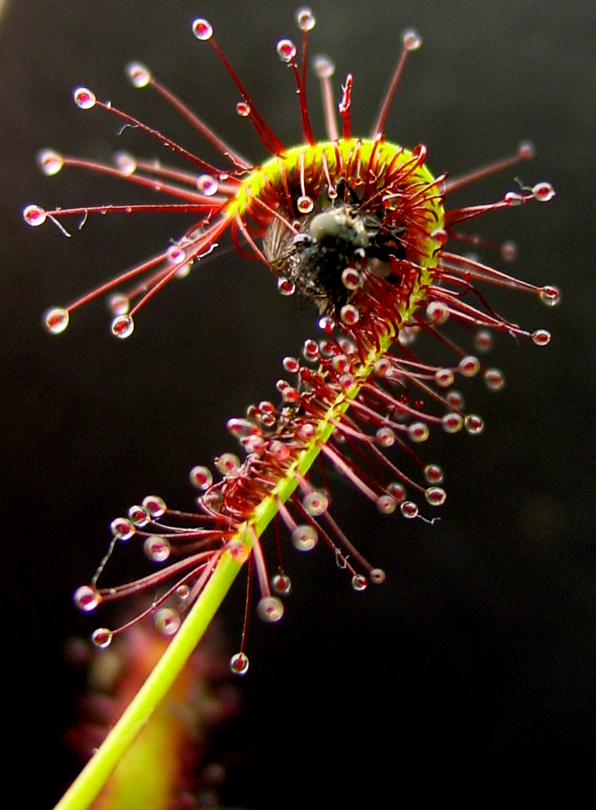
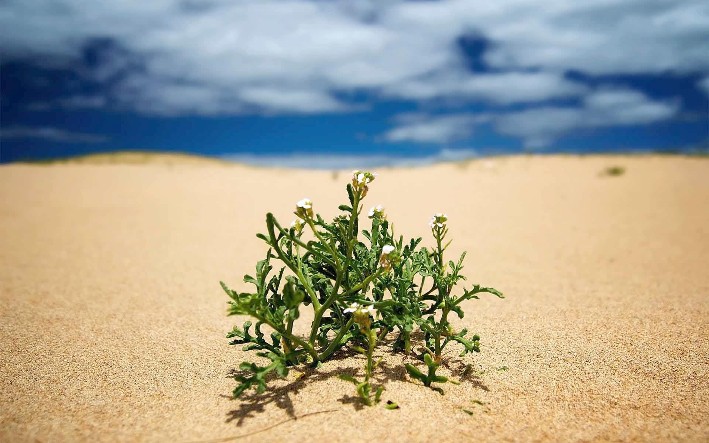
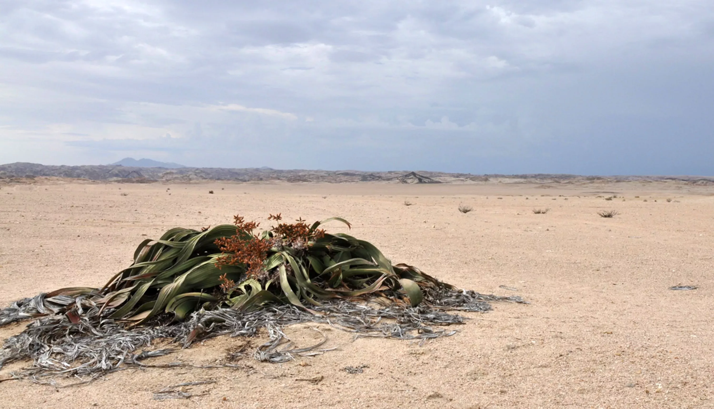
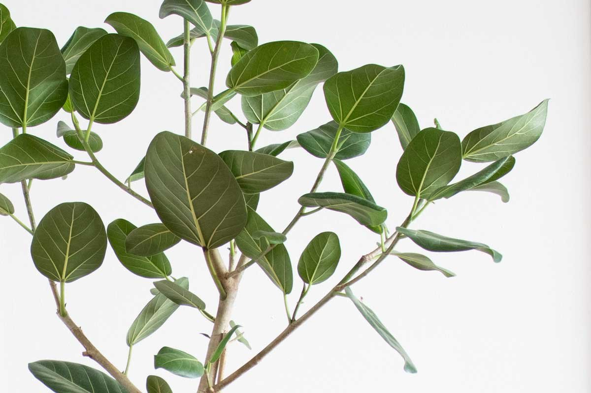
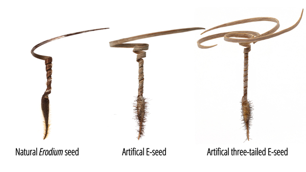
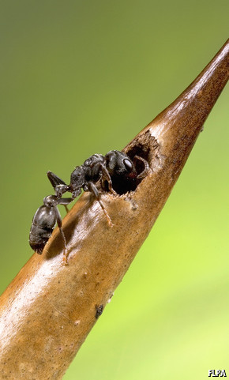
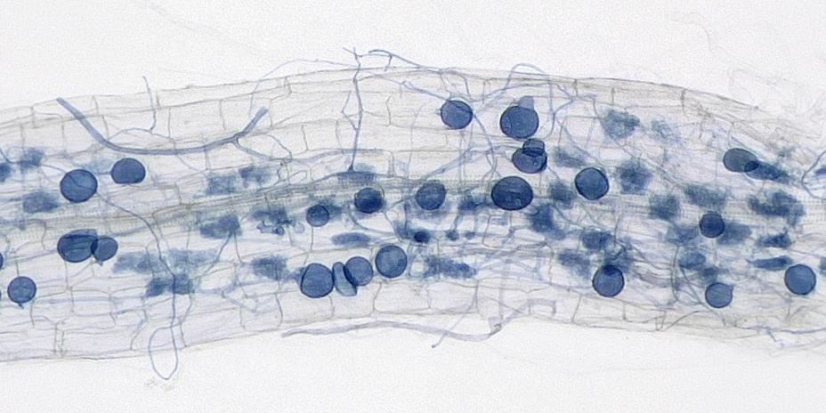

## Weird Plants {.center}

Explore fascinating adaptations and unusual characteristics of plants around the world

::: {.notes}
Welcome to the session on Weird Plants. This is an important topic in biology and science. Throughout this session, we'll explore key concepts, look at real-world examples, and think about why this matters.
:::

## Slide 2

- Introduction

## Slide 3

- What Makes a Plant "Weird"?
- "weird" is subjective, but that we'll be focusing on plants with adaptations and behaviors that are extraordinary and challenge our usual understanding of plant life

## Slide 4

- What Makes a Plant "Weird"?
- Plants that eat insects
Plants that survive in impossible places
Plants with Unusual Seeds or Fruits
Plants that protect themselves in surprising ways
Plants that talk to each other
Parasitic Plants

## Slide 5

- Why Study Weird Plants?
- weird plants teach us important lessons about survival, resilience, and the complex, interconnected web of life

## Slide 6

- Why Study Weird Plants?
- Adaptation to Challenging Environments:  Many weird plant traits developed as adaptations to harsh or specific environments
Competitive Advantage: Some unusual features evolved to give plants a leg up in their environment
Defense Against Predators: Plants can't run from herbivores, so they've developed other defenses
Unique Relationships: Some weird plants have symbiotic partnerships that help them thrive

## Slide 7

- Carnivorous Plants
- Plants that eat animals?

## Slide 8

- Carnivorous Plants
- Carnivorous plants often grow in nutrient-poor soils. 
Their ability to capture insects provides them with essential nutrients like nitrogen.

## Slide 9

- The Venus Flytrap
- Trap Type: Active snap trap
Lure: Sweet scent, reddish coloration inside the trap

## Slide 10

## Slide 11

- The Venus Flytrap
- Mechanism: Tiny trigger hairs on the trap's inner surface. When an insect touches the hairs multiple times, the trap snaps shut in a fraction of a second
Digestion: Trap seals, releasing digestive enzymes that break down the insect

## Slide 12

- The Venus Flytrap
- The Ready Position: The trap is open, with a slight outward curve, holding potential energy
Trigger!: An insect brushes the trigger hairs, sending an electrical signal
Water Moves: Cells pump water, changing shape
SNAP! The stored energy is released, and the trap flips to the closed position

## Slide 13

- Pitcher Plants
- Trap Type: Passive pitfall trap
Lure: Bright colors, nectar secretions, downward-facing hairs

## Slide 14

## Slide 15

- Pitcher Plants
- Mechanism: Insects are attracted and slip on the slippery rim into a pool of digestive liquid at the bottom. The downward-facing hairs prevent their escape
Digestion: Plant enzymes and bacteria in the liquid break down the trapped insect

## Slide 16

- Sundew Plants
- Trap Type: Active flypaper trap
Lure: Sparkling, nectar-like droplets on long, sticky hairs (tentacles)

{width="70%" fig-align="center"}

## Slide 17

## Slide 18

- Sundew Plants
- Mechanism: Insects get stuck on the sticky 'dew'. The tentacles slowly curl, further trapping the prey
Digestion: Digestive enzymes secreted by the plant dissolve the insect's body

{width="70%" fig-align="center"}

## Slide 19

- Survival Plants
- Masters of Extreme Environments

## Slide 20

- Resurrection Plant (Selaginella lepidophylla)
- Desiccation Tolerance: Can lose up to 95% of its water content and still revive when moisture returns.
Cellular Mechanisms: Special sugars and proteins protect cell structures during extreme drying.

{width="70%" fig-align="center"}

## Slide 21

## Slide 22

- Welwitschia mirabilis
- Taproot System: Reaches deep underground water sources.
Two Giant Leaves: Capture moisture from coastal fog, funnel water towards the base of the plant.

{width="70%" fig-align="center"}

## Slide 23

- Welwitschia mirabilis
- Stomata Control: Opens stomata at night to reduce water loss in the desert heat.
Research Focus: Long lifespan (1000+ years) makes it a valuable subject for studying desert plant adaptations over time.

{width="70%" fig-align="center"}

## Slide 24

- Eucalyptus
- Adaptation of Eucalyptus in fire-prone ecosystems
Epicormic Buds: Lie dormant under the bark, sprout after fires for rapid regrowth.
Fire-Dependent Seed Release: Many species release seeds from capsules after being heated by fire.

{width="70%" fig-align="center"}

## Slide 25

## Slide 26

- Plants with Unusual Seeds or Fruits
- Spectacular Strategies for Seed Dispersal

## Slide 27

- Exploding Sandbox Tree (Hura crepitans)
- Explosive Dispersal: The fruit dries, building internal pressure until it explodes, launching seeds up to 30 meters away at incredible speeds.
Purpose: Reduces competition by spreading seeds far from the parent tree.

## Slide 28

## Slide 29

- Erodium
- Hygroscopic Mechanism: The tail reacts to humidity changes; coiling when dry and uncoiling when moist.
Self-Burial: This twisting action helps the Erodium seed drill itself into the soil, promoting germination.

{width="70%" fig-align="center"}

## Slide 30

## Slide 31

- Plants with Remarkable Defensive Mechanisms
- From Spines to Poisons – How Plants Protect Themselves

## Slide 32

- Mimosa pudica 
(Sensitive Plant)
- Rapid Response: Touch triggers the release of chemicals, causing water loss in leaf cells and the dramatic folding motion.
Defense Theories: May startle herbivores, make the plant look less appealing, or dislodge small insects.

## Slide 33

## Slide 34

- Stinging Nettle 
(Urtica dioica)
- Tiny Glass Syringes: Hollow hairs filled with irritating chemicals including histamine, formic acid, and others.
Contact Defense: When touched, the hairs break and inject the irritants, causing a stinging sensation in most animals.

## Slide 35

## Slide 36

- Cacti (Family Cactaceae)
- Modified Leaves: Spines are sharp, modified leaves that deter herbivores from eating the fleshy, water-storing stems.
Additional Benefits: Spines can provide some protection from extreme desert heat.

## Slide 37

## Slide 38

- Plants with Extraordinary Symbiotic Relationships
- Partnerships for Survival and Success

## Slide 39

- Acacia Trees and Ants
- Food and Shelter: Acacia trees often have special hollow thorns for ants to live in and produce sugary nectar for the ants to eat.
Protective Army: Ants aggressively defend their acacia home from herbivores, biting and stinging anything that tries to eat the leaves.

{width="70%" fig-align="center"}

## Slide 40

## Slide 41

- Lichens
- Not One, But Two: Lichens are a partnership between a fungus and an alga (or cyanobacteria).
Teamwork: The fungus provides structure and absorbs moisture. The alga or cyanobacteria photosynthesize, providing food.
Pioneer Species: Lichens can grow in harsh environments, breaking down rock and paving the way for other life.

## Slide 42

## Slide 43

- Mycorrhizal Fungi and Plants
- Mutual Exchange: The fungus extends the plant's root system, improving water and nutrient absorption. In return, the plant provides the fungus with sugars from photosynthesis.
Ancient symbiosis: It played a crucial role in the colonization of dry land by plants, enabling them to access water and nutrients in the harsh terrestrial environment.

{width="70%" fig-align="center"}

## Slide 44

## Slide 45

- Social Life of Plants
- Suzanne Simard 
The Hidden Communication Networks of Forests

## Slide 46

- Suzanne Simard: Forest Ecologist
- Pioneering Research: Simard's studies revealed that trees are interconnected through mycorrhizal fungal networks in the soil.
Challenging Assumptions: Her work overturned the idea of trees as isolated competitors.

## Slide 47

- Mycorrhizal Networks: "The Wood Wide Web"
- Resource Sharing: Trees can send carbon, nutrients, and water to each other through the fungal network, particularly benefiting younger or shaded trees.
Warning Signals: Trees can transmit chemical signals through the network, warning neighbors about insect attacks or disease

## Slide 48

- Implications of Plant Communication
- Forest Resilience: Communication may increase the overall health and resilience of forest ecosystems.
Forest Management: Understanding these networks could change how we approach forestry, conservation, and reforestation efforts

## Slide 49

## Slide 50

- Parasitic Plants
- Plants That Steal from Other Plants

## Slide 51

- Rafflesia arnoldii 
(Corpse Flower)
- Extreme Parasitism: Rafflesia has no roots, stems, or leaves! It lives entirely inside its host plant, only emerging to bloom.
Giant Flower: The flower can reach over 3 feet in diameter, attracting pollinators with its rotting-flesh smell. It is the biggest flower on earth.

## Slide 52

## Slide 53

- Dodder (Cuscuta)
- Stem Parasite: Dodder has no chlorophyll and gets all its nutrients and water by tapping into the host's vascular system with structures called haustoria.
Aggressive Growth: Dodder can quickly smother host plants and spread from one plant to another.

## Slide 54

## Slide 55

- Mistletoe
- Hemiparasite: Mistletoe is photosynthetic, but it still steals water and some nutrients from its host tree.
Spread by Birds: Birds eat the sticky mistletoe berries and excrete the seeds onto new branches, continuing the parasitic cycle

## Slide 56

## Recap

- Key concepts reviewed
- Real-world applications explored
- Ready for assessment

## Quick Check — Live Quiz {.center}

Scan the QR code on the [session material page](index.qmd) (or ask your teacher to display it) to join the live quiz on this session.
